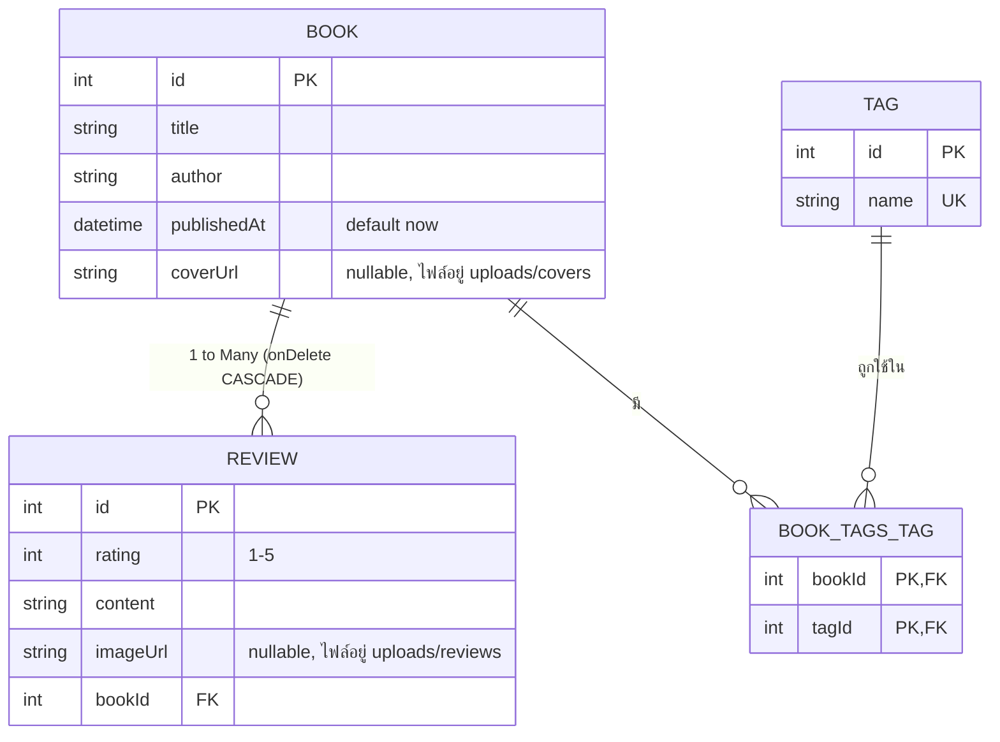
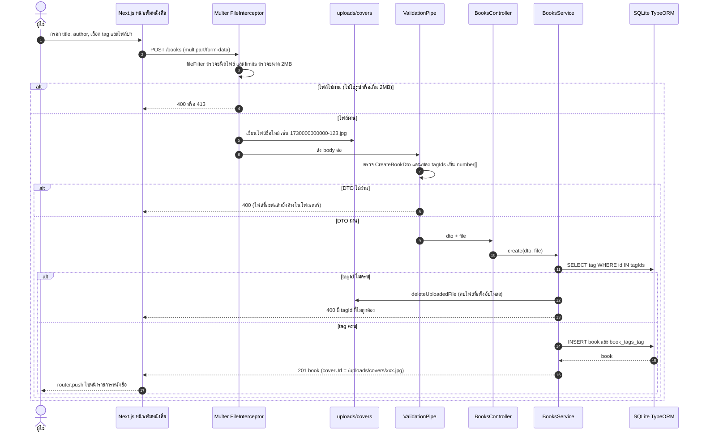
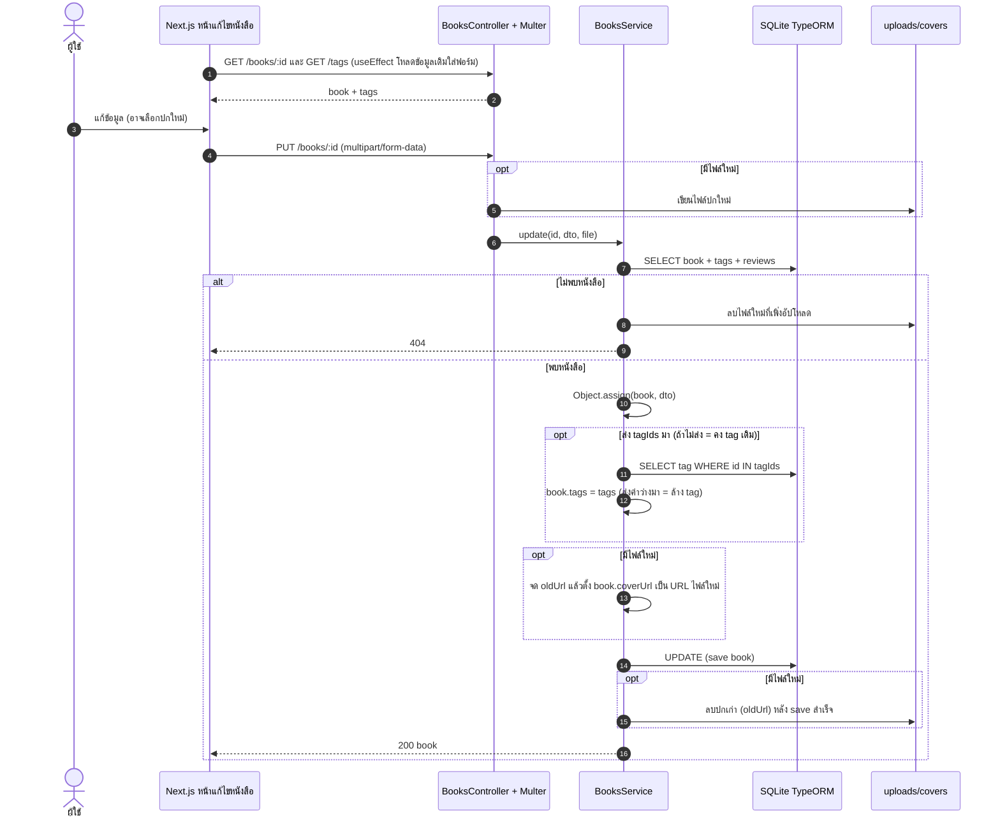
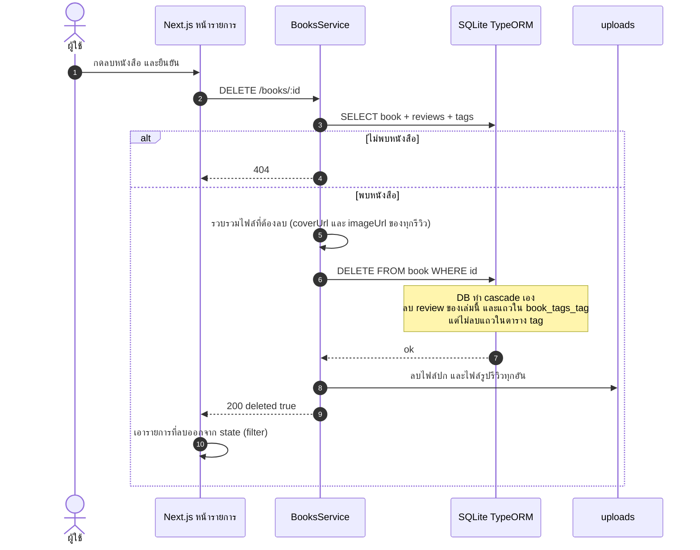
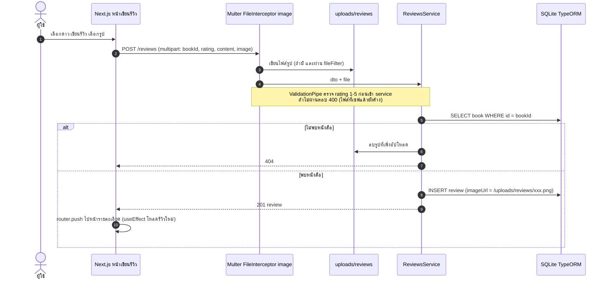
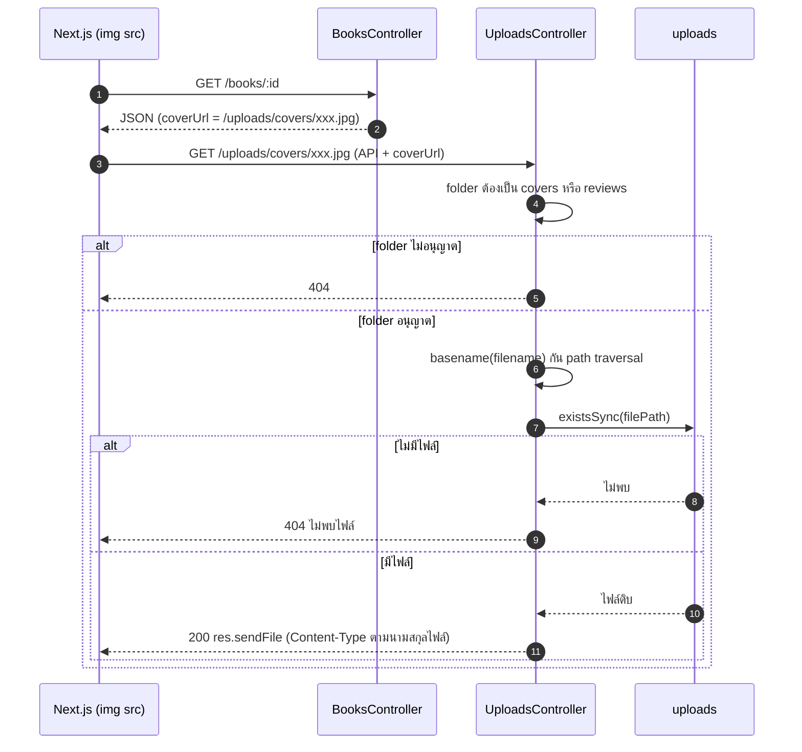
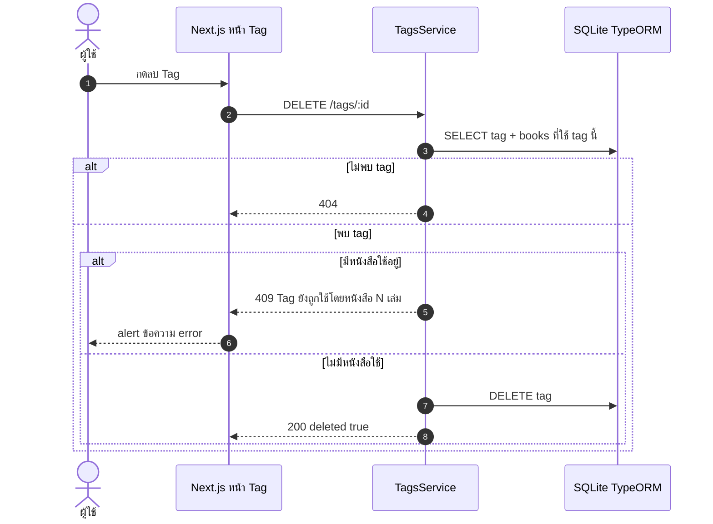

# Setup โปรเจกต์ Book / Review / Tag แบบ Step by Step (ฉบับ useEffect + Tailwind + src dir)

**Stack:** Nest.js (backend, port 3001) + TypeORM + SQLite · Next.js + Tailwind CSS + `src/` (frontend, port 3000)
**ฟีเจอร์:** CRUD 3 ตาราง (Book, Review, Tag) · อัปโหลด **ปกหนังสือ** และ **รูปใน Review** เก็บเป็นไฟล์บน Server · ส่งไฟล์กลับให้ frontend ผ่าน API · Swagger UI
**วิธีสร้างโค้ด:** ใช้ **Nest CLI** (`nest new`, `nest g resource`, `nest g module`, `nest g controller`) แล้วแก้ไฟล์ที่ gen ให้

> ทุกบล็อกโค้ดมีคอมเมนต์ภาษาไทยอธิบาย อ่านตามลำดับ Step 0 → 14 ได้เลย
> แผนภาพ ERD และ Sequence Diagram เขียนด้วย **Mermaid** (เปิดดูได้บน GitHub, VS Code ที่ลง extension "Markdown Preview Mermaid Support" หรือวางโค้ดที่ https://mermaid.live)
> DTO เขียนตามแบบที่ `nest g resource` gen ให้ คือ class-validator ล้วนๆ ไม่ใส่ decorator ของ Swagger (`ApiProperty` / `ApiPropertyOptional`)
> Frontend: ใช้ `useEffect` แบบง่าย (เขียนฟังก์ชัน `async` ไว้ใน effect) · **แยกหน้า POST (`/new`) กับหน้า PUT (`/edit`)** ไม่ใช้ฟอร์มร่วมกัน · ใช้ Tailwind + โฟลเดอร์ `src/`

## วิธีติดตั้งแบบสั้น

```bash
node -v    # ควรเป็น Node 20 ขึ้นไป (LTS)
npm -v

npm i -g @nestjs/cli   # ติดตั้ง Nest CLI (ครั้งเดียว)
nest --version
```

---

## สารบัญ

0. [ภาพรวม: ERD, Sequence Diagram และการเก็บไฟล์](#step-0)
1. [วิธีติดตั้ง (สั้นๆ)](#step-1)
2. [สร้างโปรเจกต์ Backend](#step-2)
3. [ติดตั้ง package](#step-3)
4. [ใช้ Nest CLI gen โครงของ Book / Review / Tag / Uploads](#step-4)
5. [ตั้งค่า `main.ts` (CORS, Validation, Swagger)](#step-5)
6. [ตั้งค่า `app.module.ts` (TypeORM + SQLite)](#step-6)
7. [ตัวช่วยอัปโหลดไฟล์ (`upload.util.ts`)](#step-7)
8. [โมดูล Tag](#step-8)
9. [โมดูล Book (+ อัปโหลดปก)](#step-9)
10. [โมดูล Review (+ อัปโหลดรูป)](#step-10)
11. [โมดูล Uploads (ส่งไฟล์กลับให้ frontend)](#step-11)
12. [รัน และทดสอบ Backend](#step-12)
13. [Frontend (Next.js + Tailwind + src dir)](#step-13)
14. [Checklist ทดสอบทั้งระบบ + จุดที่มักพลาด](#step-14)

---

<a id="step-0"></a>
## Step 0 ภาพรวม

### ERD (Mermaid)



> `BOOK_TAGS_TAG` คือตารางกลางที่ TypeORM สร้างให้อัตโนมัติจาก `@ManyToMany` + `@JoinTable()` (ไม่ต้องเขียน entity เอง)
> เมื่อมองข้ามตารางกลาง ความสัมพันธ์ระหว่าง Book กับ Tag คือ **Many-to-Many**

| ความสัมพันธ์ | ชนิด | พฤติกรรมตอนลบ |
|---|---|---|
| Book → Review | One-to-Many | ลบ Book → Review **ถูกลบตาม** (`onDelete: 'CASCADE'`) |
| Book ↔ Tag | Many-to-Many | ลบ Book → **Tag ไม่หาย** (ลบแค่แถวในตารางกลาง) |

### เก็บไฟล์ยังไง

- ไฟล์จริง: โฟลเดอร์ `backend/uploads/covers/` และ `backend/uploads/reviews/` (อยู่นอก `src`)
- ใน DB เก็บแค่ URL เช่น `/uploads/covers/1730000000000-123456789.jpg`
- Frontend แสดงรูปด้วย ``
- API ที่ส่งไฟล์ดิบกลับ: `GET /uploads/:folder/:filename`

### Sequence Diagrams

#### 1) เพิ่มหนังสือ + อัปโหลดปก (`POST /books`)



#### 2) แก้ไขหนังสือ / เปลี่ยนปก (`PUT /books/:id`)



#### 3) ลบหนังสือ (`DELETE /books/:id`) cascade Review และลบไฟล์



#### 4) เพิ่มรีวิว + รูป (`POST /reviews`)



#### 5) แสดงรูปปก/รูปรีวิวบนหน้าเว็บ (`GET /uploads/:folder/:filename`)



#### 6) ลบ Tag (`DELETE /tags/:id`) ห้ามลบถ้ายังถูกใช้



### โครงสร้างโปรเจกต์ที่จะได้

```
backend/
├─ uploads/                     ← สร้างอัตโนมัติตอนอัปโหลดครั้งแรก
│  ├─ covers/
│  └─ reviews/
├─ dev.db                       ← SQLite (สร้างอัตโนมัติ)
└─ src/
   ├─ main.ts
   ├─ app.module.ts
   ├─ common/upload.util.ts
   ├─ books/   (books.module / controller / service, dto/, entities/)
   ├─ reviews/ (reviews.module / controller / service, dto/, entities/)
   ├─ tags/    (tags.module / controller / service, dto/, entities/)
   └─ uploads/ (uploads.module / uploads.controller)
frontend/                       (โครงสร้างเต็มดู Step 13.2)
└─ src/
   ├─ app/        (หน้าเว็บ: books/, tags/ แยกหน้า new = POST, edit = PUT)
   ├─ components/ (Navbar.tsx)
   └─ lib/        (api.ts, types.ts, ui.ts)
```

---


<a id="step-1"></a>
## Step 1 วิธีติดตั้ง (สั้นๆ)

```bash
node -v    # ควรเป็น Node 20 ขึ้นไป (LTS)
npm -v

npm i -g @nestjs/cli   # ติดตั้ง Nest CLI (ครั้งเดียว)
nest --version
```

- ยังไม่มี Node: โหลดรุ่น **LTS** จาก https://nodejs.org (หรือ `nvm install --lts`) แล้วเปิดเทอร์มินัลใหม่
- ลง global ไม่ได้ (ไม่มีสิทธิ์): ใช้ `npx @nestjs/cli new backend` แทน แล้วในโปรเจกต์สั่ง `npx nest g ...`

---

<a id="step-2"></a>
## Step 2 สร้างโปรเจกต์ Backend

```bash
# สร้างโปรเจกต์ใหม่ชื่อ backend (ถ้าถาม package manager เลือก npm)
nest new backend --package-manager npm

cd backend
```

Nest CLI จะสร้าง `src/main.ts`, `app.module.ts`, `app.controller.ts`, `app.service.ts` ให้
**ลบ** `app.controller.ts`, `app.service.ts` (และไฟล์ `.spec.ts` ของมัน) ทิ้ง แล้วแก้ `app.module.ts` ใน Step 6

---

<a id="step-3"></a>
## Step 3 ติดตั้ง package

```bash
# TypeORM + SQLite
npm i @nestjs/typeorm typeorm sqlite3

# Validation (ตรวจข้อมูลจาก DTO) + แปลงชนิดข้อมูล
npm i class-validator class-transformer

# PartialType / OmitType ที่ nest g resource ใช้ใน update-*.dto.ts
npm i @nestjs/mapped-types

# Swagger (เอกสาร API + หน้า /docs)
npm i @nestjs/swagger

# type ของ multer (ตัวรับไฟล์ — มากับ @nestjs/platform-express อยู่แล้ว) ใช้ type ตอนเขียน TS
npm i -D @types/multer
```

> ถ้า `sqlite3` ติดตั้งไม่ผ่านบนเครื่องสอบ ใช้ `npm i better-sqlite3` แล้วเปลี่ยน `type: 'sqlite'` เป็น `type: 'better-sqlite3'` ใน Step 6

---

<a id="step-4"></a>
## Step 4 ใช้ Nest CLI gen โครงของแต่ละโมดูล

```bash
# gen "resource" = module + controller + service + dto + entity ในคำสั่งเดียว
nest g resource tags    --no-spec
nest g resource books   --no-spec
nest g resource reviews --no-spec
```

CLI จะถามสองข้อ ให้ตอบ:

```
? What transport layer do you use?   → REST API
? Would you like to generate CRUD entry points? → Y
```

(`--no-spec` = ไม่สร้างไฟล์ test ลดความรก)

แล้ว gen โมดูลสำหรับส่งไฟล์กลับ:

```bash
nest g module uploads
nest g controller uploads --no-spec
```

### สิ่งที่ CLI สร้างให้ (และจะถูกแก้ในขั้นต่อไป)

| คำสั่ง | ไฟล์ที่ได้ |
|---|---|
| `nest g resource books` | `books/books.module.ts`, `books.controller.ts`, `books.service.ts`, `dto/create-book.dto.ts`, `dto/update-book.dto.ts`, `entities/book.entity.ts` |
| `nest g resource reviews` | โครงเดียวกัน ใน `reviews/` |
| `nest g resource tags` | โครงเดียวกัน ใน `tags/` |
| `nest g module uploads` | `uploads/uploads.module.ts` (และเพิ่มเข้า `AppModule` ให้) |
| `nest g controller uploads` | `uploads/uploads.controller.ts` (และเพิ่มเข้า `UploadsModule` ให้) |

CLI **ลงทะเบียน module เข้า `AppModule.imports` ให้อัตโนมัติ** ส่วน entity/dto/controller/service ที่ gen ให้ยังเป็นโค้ดว่างๆ (มี method ตัวอย่างที่ return string) ต้องเขียนทับตาม Step 7–11

> DTO ที่ CLI gen ให้เป็น class ธรรมดา และ `update-*.dto.ts` ใช้ `PartialType` จาก `@nestjs/mapped-types` โดยไม่มี decorator ของ Swagger คู่มือนี้คงรูปแบบนั้นไว้ แค่เติม decorator ของ `class-validator` / `class-transformer` เข้าไป

สร้างโฟลเดอร์ + ไฟล์ตัวช่วยเอง (ไม่มีคำสั่ง gen):

```bash
mkdir src/common
```

---

<a id="step-5"></a>
## Step 5 `src/main.ts`

```ts
// src/main.ts
import { NestFactory } from '@nestjs/core';
import { ValidationPipe } from '@nestjs/common';
import { DocumentBuilder, SwaggerModule } from '@nestjs/swagger';
import { AppModule } from './app.module';

async function bootstrap() {
  const app = await NestFactory.create(AppModule);

  // เปิด CORS ให้ frontend (Next.js ที่ port 3000) เรียก API ได้
  // ถ้าลืมบรรทัดนี้ browser จะ error "blocked by CORS" ทั้งที่ API ใช้ได้
  app.enableCors({ origin: 'http://localhost:3000' });

  // ValidationPipe = ตรวจข้อมูลตาม decorator ใน DTO (@IsString, @Min ฯลฯ)
  //  whitelist: true  → ตัด field ที่ไม่มีใน DTO ทิ้ง
  //  transform: true  → แปลงข้อมูลเป็นชนิดตาม DTO (เช่น "5" → 5 เมื่อใช้ @Type(() => Number))
  app.useGlobalPipes(new ValidationPipe({ whitelist: true, transform: true }));

  // Swagger UI ที่ http://localhost:3001/docs  (JSON ที่ /docs-json)
  const config = new DocumentBuilder()
    .setTitle('Book API')
    .setDescription('Book / Review / Tag + อัปโหลดรูป')
    .setVersion('1.0')
    .build();
  SwaggerModule.setup('docs', app, SwaggerModule.createDocument(app, config));

  await app.listen(3001);
}
void bootstrap();
```

### 5.1 เปิด Swagger plugin ใน `nest-cli.json`

เพราะ DTO ไม่มี `@ApiProperty` ให้เปิด plugin ของ Nest เพื่อให้ Swagger อ่าน field จาก DTO ให้เอง (เพิ่มแค่บรรทัด `"plugins"`):

```json
{
  "$schema": "https://json.schemastore.org/nest-cli",
  "collection": "@nestjs/schematics",
  "sourceRoot": "src",
  "compilerOptions": {
    "deleteOutDir": true,
    "plugins": ["@nestjs/swagger"]
  }
}
```

แก้เสร็จให้หยุดแล้วรัน `npm run start:dev` ใหม่

> หมายเหตุ: `PartialType` จาก `@nestjs/mapped-types` ไม่ส่งต่อข้อมูลให้ Swagger จึงอาจเห็น body ของ `PUT /tags/:id` ว่างๆ ใน `/docs` (ไม่กระทบการทำงานจริง พิมพ์ JSON เองได้) ส่วน endpoint อัปโหลดไฟล์เรากำหนดฟอร์มเองด้วย `@ApiMultipart` ใน Step 7 จึงไม่ได้รับผลกระทบ

---

<a id="step-6"></a>
## Step 6 `src/app.module.ts`

ลบ `AppController` / `AppService` ออก ใส่ TypeORM

```ts
// src/app.module.ts
import { Module } from '@nestjs/common';
import { TypeOrmModule } from '@nestjs/typeorm';
import { BooksModule } from './books/books.module';
import { ReviewsModule } from './reviews/reviews.module';
import { TagsModule } from './tags/tags.module';
import { UploadsModule } from './uploads/uploads.module';

@Module({
  imports: [
    TypeOrmModule.forRoot({
      type: 'sqlite',
      database: 'dev.db',       // ไฟล์ฐานข้อมูล สร้างที่รากโปรเจกต์ backend
      autoLoadEntities: true,   // entity ที่ลงทะเบียนผ่าน forFeature() ในแต่ละ module จะถูกโหลดให้เอง
      synchronize: true,        // สร้าง/แก้ตารางตาม entity อัตโนมัติ (ใช้เฉพาะ dev เท่านั้น!)
    }),
    // 4 module นี้ CLI เพิ่มให้แล้วตอน gen ตรวจดูว่ามีครบ
    BooksModule,
    ReviewsModule,
    TagsModule,
    UploadsModule,
  ],
})
export class AppModule {}
```

> SQLite ใน TypeORM เปิด `PRAGMA foreign_keys = ON` ให้อัตโนมัติ ดังนั้น `onDelete: 'CASCADE'` ใช้งานได้จริง

---

<a id="step-7"></a>
## Step 7 ตัวช่วยอัปโหลดไฟล์ `src/common/upload.util.ts`

รวม logic อัปโหลดไว้ที่เดียว ใช้ซ้ำทั้งปกหนังสือและรูปรีวิว

```ts
// src/common/upload.util.ts
import { BadRequestException, applyDecorators } from '@nestjs/common';
import { ApiBody, ApiConsumes } from '@nestjs/swagger';
import { diskStorage } from 'multer';
import { existsSync, unlinkSync } from 'fs';
import { basename, extname, join } from 'path';

// โฟลเดอร์เก็บไฟล์จริง = <โปรเจกต์>/uploads  (อยู่นอก src จึงไม่โดน build ทับ)
export const UPLOAD_ROOT = join(process.cwd(), 'uploads');

// โฟลเดอร์ย่อยที่อนุญาต (ใช้ validate ใน uploads.controller ด้วย)
export const UPLOAD_FOLDERS = ['covers', 'reviews'] as const;
export type UploadFolder = (typeof UPLOAD_FOLDERS)[number];

/**
 * สร้าง options ให้ FileInterceptor
 * ใช้: FileInterceptor('cover', createUploadOptions('covers'))
 */
export function createUploadOptions(folder: UploadFolder) {
  return {
    // diskStorage = เขียนไฟล์ลงดิสก์ (ไม่เก็บไว้ใน memory)
    storage: diskStorage({
      // destination เป็น string → multer สร้างโฟลเดอร์ให้เองถ้ายังไม่มี
      destination: join(UPLOAD_ROOT, folder),
      // ตั้งชื่อไฟล์ใหม่เอง กันชื่อซ้ำ/ชื่อภาษาไทย/อักขระแปลก
      filename: (
        _req: unknown,
        file: Express.Multer.File,
        cb: (error: Error | null, filename: string) => void,
      ) => {
        const unique = `${Date.now()}-${Math.round(Math.random() * 1e9)}`;
        cb(null, `${unique}${extname(file.originalname).toLowerCase()}`);
      },
    }),

    // จำกัดขนาดไฟล์ 2MB  (เกิน → Nest ตอบ 413 Payload Too Large ให้เอง)
    limits: { fileSize: 2 * 1024 * 1024 },

    // รับเฉพาะรูป jpg / png / webp
    fileFilter: (
      _req: unknown,
      file: Express.Multer.File,
      cb: (error: Error | null, acceptFile: boolean) => void,
    ) => {
      if (!/^image\/(jpeg|png|webp)$/.test(file.mimetype)) {
        return cb(new BadRequestException('รองรับเฉพาะไฟล์ jpg, png, webp'), false);
      }
      cb(null, true);
    },
  };
}

/**
 * ตัวช่วยสำหรับ Swagger UI: บอกว่า endpoint รับ multipart/form-data และมีช่องเลือกไฟล์
 * ใช้ทดสอบผ่าน /docs เท่านั้น ไม่กระทบการทำงานจริง และไม่ต้องแก้อะไรใน DTO
 * ใช้: @ApiMultipart('cover', { title: { type: 'string' } })
 *      - อาร์กิวเมนต์ที่ 1 = ชื่อ field ไฟล์ (ต้องตรงกับ FileInterceptor)
 *      - อาร์กิวเมนต์ที่ 2 = field ข้อความอื่นๆ ที่อยากให้โชว์ในฟอร์ม
 */
export function ApiMultipart(fileField: string, fields: Record<string, any> = {}) {
  return applyDecorators(
    ApiConsumes('multipart/form-data'),
    ApiBody({
      schema: {
        type: 'object',
        properties: { ...fields, [fileField]: { type: 'string', format: 'binary' } },
      },
    }),
  );
}

/** แปลงชื่อไฟล์เป็น URL ที่เก็บใน DB เช่น /uploads/covers/xxx.jpg */
export function buildFileUrl(folder: UploadFolder, filename: string) {
  return `/uploads/${folder}/${filename}`;
}

/**
 * ลบไฟล์จริงจากดิสก์ โดยรับ URL ที่เก็บใน DB (เช่น /uploads/covers/xxx.jpg)
 * รับ null/undefined ได้ (ไม่ทำอะไร) จะได้เรียกได้เลยไม่ต้องเช็คก่อน
 */
export function deleteUploadedFile(url?: string | null) {
  if (!url) return;
  const [, , folder, name] = url.split('/'); // ['', 'uploads', 'covers', 'xxx.jpg']
  if (!UPLOAD_FOLDERS.includes(folder as UploadFolder) || !name) return;
  // basename() กัน path traversal เช่น ../../etc/passwd
  const filePath = join(UPLOAD_ROOT, folder, basename(name));
  if (existsSync(filePath)) unlinkSync(filePath);
}
```

---

<a id="step-8"></a>
## Step 8 โมดูล Tag

### 8.1 Entity — `src/tags/entities/tag.entity.ts`

```ts
// src/tags/entities/tag.entity.ts
import { Column, Entity, ManyToMany, PrimaryGeneratedColumn } from 'typeorm';
import { Book } from '../../books/entities/book.entity';

@Entity()
export class Tag {
  @PrimaryGeneratedColumn()
  id: number;

  // unique = ชื่อ tag ห้ามซ้ำ
  @Column({ unique: true })
  name: string;

  // ฝั่ง "ไม่ใช่เจ้าของ" ของ Many-to-Many (ไม่ใส่ @JoinTable ที่นี่ และไม่ใส่ cascade)
  @ManyToMany(() => Book, (book) => book.tags)
  books: Book[];
}
```

### 8.2 DTO

```ts
// src/tags/dto/create-tag.dto.ts
import { IsNotEmpty, IsString, MaxLength } from 'class-validator';

export class CreateTagDto {
  @IsString()
  @IsNotEmpty()
  @MaxLength(50)
  name: string;
}
```

```ts
// src/tags/dto/update-tag.dto.ts
import { PartialType } from '@nestjs/mapped-types'; // PartialType = ทำให้ทุก field ใน CreateTagDto เป็น optional (เหมือนที่ nest g res gen ให้)
import { CreateTagDto } from './create-tag.dto';

export class UpdateTagDto extends PartialType(CreateTagDto) {}
```

> ไฟล์ `update-tag.dto.ts` ที่ `nest g resource` gen ให้ก็หน้าตาแบบนี้อยู่แล้ว ไม่ต้องแก้อะไรเพิ่ม

### 8.3 Service — `src/tags/tags.service.ts`

```ts
// src/tags/tags.service.ts
import { ConflictException, Injectable, NotFoundException } from '@nestjs/common';
import { InjectRepository } from '@nestjs/typeorm';
import { Repository } from 'typeorm';
import { CreateTagDto } from './dto/create-tag.dto';
import { UpdateTagDto } from './dto/update-tag.dto';
import { Tag } from './entities/tag.entity';

@Injectable()
export class TagsService {
  // @InjectRepository(Tag) = ขอ Repository ของ Tag มาใช้ query ตาราง tag
  constructor(@InjectRepository(Tag) private readonly repo: Repository<Tag>) {}

  findAll() {
    return this.repo.find({ order: { name: 'ASC' } });
  }

  async findOne(id: number) {
    const tag = await this.repo.findOneBy({ id });
    if (!tag) throw new NotFoundException('ไม่พบ Tag');
    return tag;
  }

  async create(dto: CreateTagDto) {
    // เช็คชื่อซ้ำก่อน เพื่อตอบ 409 ที่อ่านรู้เรื่อง (แทน error ดิบจาก DB)
    if (await this.repo.findOneBy({ name: dto.name })) {
      throw new ConflictException('ชื่อ Tag นี้มีอยู่แล้ว');
    }
    return this.repo.save(this.repo.create(dto));
  }

  async update(id: number, dto: UpdateTagDto) {
    const tag = await this.findOne(id);
    if (dto.name && dto.name !== tag.name) {
      if (await this.repo.findOneBy({ name: dto.name })) {
        throw new ConflictException('ชื่อ Tag นี้มีอยู่แล้ว');
      }
      tag.name = dto.name;
    }
    return this.repo.save(tag);
  }

  async remove(id: number) {
    // โหลด books ที่ใช้ tag นี้มาด้วย เพื่อเช็คว่ายังถูกใช้อยู่ไหม
    const tag = await this.repo.findOne({ where: { id }, relations: { books: true } });
    if (!tag) throw new NotFoundException('ไม่พบ Tag');

    // นโยบาย: ห้ามลบ Tag ที่ยังมีหนังสือใช้อยู่ (ปลอดภัยสุด)
    // ถ้าโจทย์ให้ลบได้เลย: ลบ if นี้ออก — TypeORM จะลบแค่แถวในตารางกลาง หนังสือไม่หาย
    if (tag.books.length > 0) {
      throw new ConflictException(`Tag นี้ยังถูกใช้โดยหนังสือ ${tag.books.length} เล่ม`);
    }
    await this.repo.remove(tag);
    return { deleted: true };
  }
}
```

### 8.4 Controller — `src/tags/tags.controller.ts`

```ts
// src/tags/tags.controller.ts
import { Body, Controller, Delete, Get, Param, ParseIntPipe, Post, Put } from '@nestjs/common';
import { ApiTags } from '@nestjs/swagger';
import { CreateTagDto } from './dto/create-tag.dto';
import { UpdateTagDto } from './dto/update-tag.dto';
import { TagsService } from './tags.service';

@ApiTags('tags')        // จัดกลุ่มใน Swagger UI
@Controller('tags')     // prefix ของทุก route ในนี้ = /tags
export class TagsController {
  constructor(private readonly tagsService: TagsService) {}

  @Get()                // GET /tags
  findAll() {
    return this.tagsService.findAll();
  }

  @Get(':id')           // GET /tags/1   (ParseIntPipe แปลง "1" → 1 และ 400 ถ้าไม่ใช่ตัวเลข)
  findOne(@Param('id', ParseIntPipe) id: number) {
    return this.tagsService.findOne(id);
  }

  @Post()               // POST /tags
  create(@Body() dto: CreateTagDto) {
    return this.tagsService.create(dto);
  }

  // CLI gen ให้เป็น @Patch ถ้าโจทย์/Swagger ของอาจารย์ใช้ PUT ให้เปลี่ยนเป็น @Put ตามโจทย์
  @Put(':id')           // PUT /tags/1
  update(@Param('id', ParseIntPipe) id: number, @Body() dto: UpdateTagDto) {
    return this.tagsService.update(id, dto);
  }

  @Delete(':id')        // DELETE /tags/1
  remove(@Param('id', ParseIntPipe) id: number) {
    return this.tagsService.remove(id);
  }
}
```

### 8.5 Module — `src/tags/tags.module.ts`

```ts
// src/tags/tags.module.ts
import { Module } from '@nestjs/common';
import { TypeOrmModule } from '@nestjs/typeorm';
import { Tag } from './entities/tag.entity';
import { TagsController } from './tags.controller';
import { TagsService } from './tags.service';

@Module({
  // forFeature = ลงทะเบียน entity ที่ module นี้ใช้ (และ autoLoadEntities จะพา entity ไปสร้างตารางให้)
  imports: [TypeOrmModule.forFeature([Tag])],
  controllers: [TagsController],
  providers: [TagsService],
})
export class TagsModule {}
```

---

<a id="step-9"></a>
## Step 9 โมดูล Book (+ อัปโหลดปก)

### 9.1 Entity — `src/books/entities/book.entity.ts`

```ts
// src/books/entities/book.entity.ts
import {
  Column, CreateDateColumn, Entity, JoinTable,
  ManyToMany, OneToMany, PrimaryGeneratedColumn,
} from 'typeorm';
import { Review } from '../../reviews/entities/review.entity';
import { Tag } from '../../tags/entities/tag.entity';

@Entity()
export class Book {
  @PrimaryGeneratedColumn()
  id: number;

  @Column()
  title: string;

  @Column()
  author: string;

  // CreateDateColumn = ใส่วันเวลาปัจจุบันให้อัตโนมัติตอนสร้าง (เทียบเท่า @default(now()))
  @CreateDateColumn()
  publishedAt: Date;

  // nullable = ไม่บังคับมีปก
  // ต้องระบุ type: 'varchar' เอง เพราะ TypeScript type "string | null" TypeORM อ่านชนิดไม่ออก
  @Column({ type: 'varchar', nullable: true })
  coverUrl: string | null;

  // One-to-Many: หนังสือ 1 เล่มมีหลายรีวิว (ฝั่ง FK อยู่ที่ Review.bookId)
  @OneToMany(() => Review, (review) => review.book)
  reviews: Review[];

  // Many-to-Many: ไม่ใส่ cascade → ลบหนังสือแล้ว Tag ไม่หาย
  // @JoinTable() ใส่ "ฝั่งเดียว" (ฝั่งเจ้าของ) เพื่อสร้างตารางกลาง book_tags_tag
  @ManyToMany(() => Tag, (tag) => tag.books)
  @JoinTable()
  tags: Tag[];
}
```

### 9.2 DTO

```ts
// src/books/dto/create-book.dto.ts
import { Transform } from 'class-transformer';
import { IsInt, IsNotEmpty, IsOptional, IsString } from 'class-validator';

export class CreateBookDto {
  @IsString()
  @IsNotEmpty()
  title: string;

  @IsString()
  @IsNotEmpty()
  author: string;

  // ข้อมูลจาก multipart/form-data ทุกค่าเป็น string
  //  - ส่ง tagIds ตัวเดียว → ได้ "1" (ไม่ใช่ array)
  //  - ส่งหลายตัว         → ได้ ["1","2"]
  //  - ส่งค่าว่าง ""       → หมายถึง "ไม่มี tag"
  // @Transform แปลงทุกกรณีให้เป็น number[] ก่อนตรวจ @IsInt({ each: true })
  @IsOptional()
  @Transform(({ value }) =>
    value === '' || value == null ? [] : ([] as unknown[]).concat(value).map(Number),
  )
  @IsInt({ each: true })
  tagIds?: number[];

  // ไฟล์ปกไม่ต้องประกาศใน DTO: multer จัดการแยก แล้วส่งให้ controller ผ่าน @UploadedFile()
}
```

```ts
// src/books/dto/update-book.dto.ts
import { PartialType } from '@nestjs/mapped-types';
import { CreateBookDto } from './create-book.dto';

// ทุก field optional: ส่งมาเฉพาะที่ต้องการแก้
export class UpdateBookDto extends PartialType(CreateBookDto) {}
```

### 9.3 Service — `src/books/books.service.ts`

```ts
// src/books/books.service.ts
import { BadRequestException, Injectable, NotFoundException } from '@nestjs/common';
import { InjectRepository } from '@nestjs/typeorm';
import { In, Repository } from 'typeorm';
import { buildFileUrl, deleteUploadedFile } from '../common/upload.util';
import { Tag } from '../tags/entities/tag.entity';
import { CreateBookDto } from './dto/create-book.dto';
import { UpdateBookDto } from './dto/update-book.dto';
import { Book } from './entities/book.entity';

@Injectable()
export class BooksService {
  constructor(
    @InjectRepository(Book) private readonly repo: Repository<Book>,
    @InjectRepository(Tag) private readonly tagRepo: Repository<Tag>,
  ) {}

  // รายการหนังสือ + tag ของแต่ละเล่ม (relations ต้องระบุเอง ไม่งั้น tags จะไม่ติดมา)
  findAll() {
    return this.repo.find({ relations: { tags: true }, order: { id: 'DESC' } });
  }

  // รายละเอียดหนังสือ + tags + reviews (รีวิวใหม่สุดก่อน)
  async findOne(id: number) {
    const book = await this.repo.findOne({
      where: { id },
      relations: { tags: true, reviews: true },
      order: { reviews: { id: 'DESC' } },
    });
    if (!book) throw new NotFoundException('ไม่พบหนังสือ');
    return book;
  }

  // แปลง tagIds → entity Tag  (ถ้ามี id ที่ไม่มีอยู่จริงให้ error)
  private async loadTags(tagIds: number[] = []) {
    if (tagIds.length === 0) return [];
    const unique = [...new Set(tagIds)];
    const tags = await this.tagRepo.findBy({ id: In(unique) });
    if (tags.length !== unique.length) throw new BadRequestException('มี tagId ที่ไม่ถูกต้อง');
    return tags;
  }

  async create(dto: CreateBookDto, file?: Express.Multer.File) {
    const coverUrl = file ? buildFileUrl('covers', file.filename) : null;
    const { tagIds, ...data } = dto; // แยก tagIds ออก เพราะ entity ไม่มี field นี้
    try {
      const tags = await this.loadTags(tagIds);
      return await this.repo.save(this.repo.create({ ...data, tags, coverUrl }));
    } catch (e) {
      // multer เขียนไฟล์ลงดิสก์ไปแล้วก่อนถึงตรงนี้ ถ้าบันทึกไม่สำเร็จต้องลบไฟล์ทิ้ง ไม่ให้ค้าง
      deleteUploadedFile(coverUrl);
      throw e;
    }
  }

  async update(id: number, dto: UpdateBookDto, file?: Express.Multer.File) {
    const newUrl = file ? buildFileUrl('covers', file.filename) : null;
    try {
      const book = await this.findOne(id);
      const { tagIds, ...data } = dto;
      Object.assign(book, data); // อัปเดต title/author ที่ส่งมา

      // tagIds === undefined → ไม่ได้ส่งมา = คง tag เดิม
      // tagIds เป็น []        → ล้าง tag ทั้งหมด
      if (tagIds !== undefined) book.tags = await this.loadTags(tagIds);

      const oldUrl = book.coverUrl;
      if (newUrl) book.coverUrl = newUrl; // ไม่ส่งไฟล์ใหม่ = คงปกเดิม

      const saved = await this.repo.save(book);
      if (newUrl) deleteUploadedFile(oldUrl); // ลบปกเก่า "หลัง" บันทึกสำเร็จเท่านั้น
      return saved;
    } catch (e) {
      deleteUploadedFile(newUrl); // บันทึกไม่สำเร็จ → ลบไฟล์ใหม่ที่เพิ่งอัปโหลด
      throw e;
    }
  }

  async remove(id: number) {
    const book = await this.findOne(id); // รวม reviews มาด้วย

    // เก็บ path ไฟล์ทั้งหมดไว้ก่อนลบ: ปกหนังสือ + รูปรีวิวทุกอัน
    const files = [book.coverUrl, ...book.reviews.map((r) => r.imageUrl)];

    // delete(id) → DB ทำ cascade เอง: Review หายตาม, แถวตารางกลางหาย, Tag ยังอยู่
    await this.repo.delete(id);

    // DB cascade ลบแค่ "แถว" ไม่ลบ "ไฟล์" จึงต้องลบไฟล์เอง
    files.forEach((url) => deleteUploadedFile(url));
    return { deleted: true };
  }
}
```

### 9.4 Controller — `src/books/books.controller.ts`

```ts
// src/books/books.controller.ts
import {
  Body, Controller, Delete, Get, Param, ParseIntPipe,
  Post, Put, UploadedFile, UseInterceptors,
} from '@nestjs/common';
import { FileInterceptor } from '@nestjs/platform-express';
import { ApiTags } from '@nestjs/swagger';
import { ApiMultipart, createUploadOptions } from '../common/upload.util';
import { BooksService } from './books.service';
import { CreateBookDto } from './dto/create-book.dto';
import { UpdateBookDto } from './dto/update-book.dto';

// field ที่จะโชว์ในฟอร์มของ Swagger UI (ใช้ทดสอบเท่านั้น ไม่กระทบการทำงานจริง)
const BOOK_FIELDS = {
  title: { type: 'string' },
  author: { type: 'string' },
  tagIds: { type: 'array', items: { type: 'integer' } },
};

@ApiTags('books')
@Controller('books')
export class BooksController {
  constructor(private readonly booksService: BooksService) {}

  @Post()
  @ApiMultipart('cover', BOOK_FIELDS) // บอก Swagger ว่ารับ multipart + ช่องไฟล์ชื่อ cover (ดู Step 7)
  // FileInterceptor('cover', ...) → รับไฟล์จาก field ชื่อ "cover" แล้วเซฟลง uploads/covers
  // ชื่อ 'cover' ต้องตรงกับ name="cover" ของ <input type="file"> ฝั่ง frontend
  @UseInterceptors(FileInterceptor('cover', createUploadOptions('covers')))
  create(
    @Body() dto: CreateBookDto,
    @UploadedFile() file?: Express.Multer.File, // ? = ไม่ส่งไฟล์มาก็ได้
  ) {
    return this.booksService.create(dto, file);
  }

  @Get()
  findAll() {
    return this.booksService.findAll();
  }

  @Get(':id')
  findOne(@Param('id', ParseIntPipe) id: number) {
    return this.booksService.findOne(id);
  }

  @Put(':id')
  @ApiMultipart('cover', BOOK_FIELDS)
  @UseInterceptors(FileInterceptor('cover', createUploadOptions('covers')))
  update(
    @Param('id', ParseIntPipe) id: number,
    @Body() dto: UpdateBookDto,
    @UploadedFile() file?: Express.Multer.File,
  ) {
    return this.booksService.update(id, dto, file);
  }

  @Delete(':id')
  remove(@Param('id', ParseIntPipe) id: number) {
    return this.booksService.remove(id);
  }
}
```

### 9.5 Module — `src/books/books.module.ts`

```ts
// src/books/books.module.ts
import { Module } from '@nestjs/common';
import { TypeOrmModule } from '@nestjs/typeorm';
import { Tag } from '../tags/entities/tag.entity';
import { BooksController } from './books.controller';
import { BooksService } from './books.service';
import { Book } from './entities/book.entity';

@Module({
  // Service ใช้ทั้ง Book และ Tag repository จึงลงทะเบียนทั้งคู่
  imports: [TypeOrmModule.forFeature([Book, Tag])],
  controllers: [BooksController],
  providers: [BooksService],
})
export class BooksModule {}
```

---

<a id="step-10"></a>
## Step 10 โมดูล Review (+ อัปโหลดรูป)

### 10.1 Entity — `src/reviews/entities/review.entity.ts`

```ts
// src/reviews/entities/review.entity.ts
import { Column, Entity, JoinColumn, ManyToOne, PrimaryGeneratedColumn } from 'typeorm';
import { Book } from '../../books/entities/book.entity';

@Entity()
export class Review {
  @PrimaryGeneratedColumn()
  id: number;

  @Column()
  rating: number; // 1-5 (ตรวจใน DTO)

  @Column()
  content: string;

  // รูปประกอบรีวิว (ไม่บังคับ)
  @Column({ type: 'varchar', nullable: true })
  imageUrl: string | null;

  // คอลัมน์ FK ที่เข้าถึงเป็นตัวเลขได้ตรงๆ (ใช้ where: { bookId } ได้)
  @Column()
  bookId: number;

  // Many-to-One: รีวิวหลายอันเป็นของหนังสือเล่มเดียว
  // onDelete: 'CASCADE' → ลบ Book แล้ว Review ของเล่มนั้นถูกลบตามที่ระดับ DB
  @ManyToOne(() => Book, (book) => book.reviews, { onDelete: 'CASCADE' })
  @JoinColumn({ name: 'bookId' }) // ผูกความสัมพันธ์เข้ากับคอลัมน์ bookId ด้านบน
  book: Book;
}
```

### 10.2 DTO

```ts
// src/reviews/dto/create-review.dto.ts
import { Type } from 'class-transformer';
import { IsInt, IsNotEmpty, IsString, Max, Min } from 'class-validator';

export class CreateReviewDto {
  // multipart ส่งตัวเลขมาเป็น string → @Type(() => Number) แปลงเป็น number ก่อนตรวจ
  @Type(() => Number)
  @IsInt()
  bookId: number;

  @Type(() => Number)
  @IsInt()
  @Min(1)   // โจทย์: rating ต้อง 1-5
  @Max(5)
  rating: number;

  @IsString()
  @IsNotEmpty()
  content: string;

  // รูปรีวิวไม่ต้องประกาศใน DTO: multer จัดการแยก แล้วส่งให้ controller ผ่าน @UploadedFile()
}
```

```ts
// src/reviews/dto/update-review.dto.ts
import { OmitType, PartialType } from '@nestjs/mapped-types';
import { CreateReviewDto } from './create-review.dto';

// แก้รีวิวได้เฉพาะ rating/content/image — ห้ามย้ายรีวิวไปหนังสือเล่มอื่น (ตัด bookId ออก)
export class UpdateReviewDto extends PartialType(OmitType(CreateReviewDto, ['bookId'] as const)) {}
```

### 10.3 Service — `src/reviews/reviews.service.ts`

```ts
// src/reviews/reviews.service.ts
import { Injectable, NotFoundException } from '@nestjs/common';
import { InjectRepository } from '@nestjs/typeorm';
import { Repository } from 'typeorm';
import { Book } from '../books/entities/book.entity';
import { buildFileUrl, deleteUploadedFile } from '../common/upload.util';
import { CreateReviewDto } from './dto/create-review.dto';
import { UpdateReviewDto } from './dto/update-review.dto';
import { Review } from './entities/review.entity';

@Injectable()
export class ReviewsService {
  constructor(
    @InjectRepository(Review) private readonly repo: Repository<Review>,
    @InjectRepository(Book) private readonly bookRepo: Repository<Book>, // ใช้เช็คว่า bookId มีจริง
  ) {}

  // GET /reviews หรือ GET /reviews?bookId=1
  findAll(bookId?: number) {
    return this.repo.find({ where: bookId ? { bookId } : {}, order: { id: 'DESC' } });
  }

  async findOne(id: number) {
    const review = await this.repo.findOneBy({ id });
    if (!review) throw new NotFoundException('ไม่พบรีวิว');
    return review;
  }

  async create(dto: CreateReviewDto, file?: Express.Multer.File) {
    const imageUrl = file ? buildFileUrl('reviews', file.filename) : null;
    try {
      const book = await this.bookRepo.findOneBy({ id: dto.bookId });
      if (!book) throw new NotFoundException('ไม่พบหนังสือที่ต้องการรีวิว');

      return await this.repo.save(
        this.repo.create({
          bookId: dto.bookId,
          rating: dto.rating,
          content: dto.content,
          imageUrl,
        }),
      );
    } catch (e) {
      deleteUploadedFile(imageUrl); // ไฟล์ถูกเซฟไปแล้ว แต่บันทึกไม่ผ่าน → ลบทิ้ง
      throw e;
    }
  }

  async update(id: number, dto: UpdateReviewDto, file?: Express.Multer.File) {
    const newUrl = file ? buildFileUrl('reviews', file.filename) : null;
    try {
      const review = await this.findOne(id);
      const oldUrl = review.imageUrl;

      if (dto.rating !== undefined) review.rating = dto.rating;
      if (dto.content !== undefined) review.content = dto.content;
      if (newUrl) review.imageUrl = newUrl; // ไม่ส่งรูปใหม่ = คงรูปเดิม

      const saved = await this.repo.save(review);
      if (newUrl) deleteUploadedFile(oldUrl); // ลบรูปเก่าหลังบันทึกสำเร็จ
      return saved;
    } catch (e) {
      deleteUploadedFile(newUrl);
      throw e;
    }
  }

  async remove(id: number) {
    const review = await this.findOne(id);
    const imageUrl = review.imageUrl; // จดไว้ก่อน เพราะหลัง remove() entity จะถูกล้างค่า
    await this.repo.remove(review);
    deleteUploadedFile(imageUrl); // ลบไฟล์รูปด้วย
    return { deleted: true };
  }
}
```

### 10.4 Controller — `src/reviews/reviews.controller.ts`

```ts
// src/reviews/reviews.controller.ts
import {
  Body, Controller, Delete, Get, Param, ParseIntPipe, Post,
  Put, Query, UploadedFile, UseInterceptors,
} from '@nestjs/common';
import { FileInterceptor } from '@nestjs/platform-express';
import { ApiQuery, ApiTags } from '@nestjs/swagger';
import { ApiMultipart, createUploadOptions } from '../common/upload.util';
import { CreateReviewDto } from './dto/create-review.dto';
import { UpdateReviewDto } from './dto/update-review.dto';
import { ReviewsService } from './reviews.service';

// field ที่จะโชว์ในฟอร์มของ Swagger UI (ใช้ทดสอบเท่านั้น)
const REVIEW_FIELDS = {
  rating: { type: 'integer', minimum: 1, maximum: 5 },
  content: { type: 'string' },
};

@ApiTags('reviews')
@Controller('reviews')
export class ReviewsController {
  constructor(private readonly reviewsService: ReviewsService) {}

  @Post()
  @ApiMultipart('image', { bookId: { type: 'integer' }, ...REVIEW_FIELDS }) // ตอนสร้างต้องส่ง bookId
  // รับไฟล์จาก field ชื่อ "image" เซฟลง uploads/reviews
  @UseInterceptors(FileInterceptor('image', createUploadOptions('reviews')))
  create(@Body() dto: CreateReviewDto, @UploadedFile() file?: Express.Multer.File) {
    return this.reviewsService.create(dto, file);
  }

  @Get()
  @ApiQuery({ name: 'bookId', required: false, type: Number })
  findAll(
    // optional: true = ไม่ส่ง ?bookId มาก็ได้ (ได้รีวิวทั้งหมด)
    @Query('bookId', new ParseIntPipe({ optional: true })) bookId?: number,
  ) {
    return this.reviewsService.findAll(bookId);
  }

  @Get(':id')
  findOne(@Param('id', ParseIntPipe) id: number) {
    return this.reviewsService.findOne(id);
  }

  @Put(':id')
  @ApiMultipart('image', REVIEW_FIELDS) // ตอนแก้ไม่ส่ง bookId
  @UseInterceptors(FileInterceptor('image', createUploadOptions('reviews')))
  update(
    @Param('id', ParseIntPipe) id: number,
    @Body() dto: UpdateReviewDto,
    @UploadedFile() file?: Express.Multer.File,
  ) {
    return this.reviewsService.update(id, dto, file);
  }

  @Delete(':id')
  remove(@Param('id', ParseIntPipe) id: number) {
    return this.reviewsService.remove(id);
  }
}
```

### 10.5 Module — `src/reviews/reviews.module.ts`

```ts
// src/reviews/reviews.module.ts
import { Module } from '@nestjs/common';
import { TypeOrmModule } from '@nestjs/typeorm';
import { Book } from '../books/entities/book.entity';
import { Review } from './entities/review.entity';
import { ReviewsController } from './reviews.controller';
import { ReviewsService } from './reviews.service';

@Module({
  imports: [TypeOrmModule.forFeature([Review, Book])], // Service ใช้ Book repository ด้วย
  controllers: [ReviewsController],
  providers: [ReviewsService],
})
export class ReviewsModule {}
```

---

<a id="step-11"></a>
## Step 11 โมดูล Uploads (ส่งไฟล์ดิบกลับให้ frontend ผ่าน API)

`UploadsModule` ที่ CLI gen ให้ ไม่ต้องแก้ แก้เฉพาะ controller:

```ts
// src/uploads/uploads.controller.ts
import { Controller, Get, NotFoundException, Param, Res } from '@nestjs/common';
import { ApiTags } from '@nestjs/swagger';
import type { Response } from 'express'; // ใช้ "import type" เพราะเป็นแค่ type ไม่ใช่ class จริง
import { existsSync } from 'fs';
import { basename, join } from 'path';
import { UPLOAD_FOLDERS, UPLOAD_ROOT } from '../common/upload.util';

@ApiTags('uploads')
@Controller('uploads')
export class UploadsController {
  // GET /uploads/covers/xxx.jpg   หรือ   GET /uploads/reviews/xxx.png
  @Get(':folder/:filename')
  serve(
    @Param('folder') folder: string,
    @Param('filename') filename: string,
    @Res() res: Response, // @Res() = เราตอบกลับเอง (ส่งไฟล์) ไม่ใช้การ return JSON ปกติ
  ) {
    // อนุญาตเฉพาะโฟลเดอร์ที่กำหนด กันเข้าถึงโฟลเดอร์อื่นในเครื่อง
    if (!(UPLOAD_FOLDERS as readonly string[]).includes(folder)) {
      throw new NotFoundException();
    }

    // basename() ตัด "../" ออก กัน path traversal
    const filePath = join(UPLOAD_ROOT, folder, basename(filename));
    if (!existsSync(filePath)) throw new NotFoundException('ไม่พบไฟล์');

    // sendFile ส่งไฟล์ดิบ และตั้ง Content-Type ตามนามสกุลให้เอง (image/jpeg, image/png ...)
    return res.sendFile(filePath);
  }
}
```

> ทางเลือก: ใช้ `app.useStaticAssets(UPLOAD_ROOT, { prefix: '/uploads/' })` (ต้องสร้าง app เป็น `NestExpressApplication`) ได้ผลเหมือนกัน แต่ controller ด้านบนเป็น "API" ตรงตามโจทย์และคุมสิทธิ์ได้ง่ายกว่า

---

<a id="step-12"></a>
## Step 12 รัน และทดสอบ Backend

```bash
npm run start:dev
```

ถ้าสำเร็จจะเห็น route ทั้งหมดใน log (`Mapped {/books, POST} route` ฯลฯ) และมีไฟล์ `dev.db` โผล่ที่รากโปรเจกต์

### 12.1 ทดสอบผ่าน Swagger UI

เปิด **http://localhost:3001/docs** ลำดับทดสอบ:

1. `POST /tags` → `{"name":"Programming"}` และ `{"name":"Classic"}`
2. `POST /books` (เลือก Try it out → กรอก title, author, เลือกไฟล์ cover, tagIds) → ดู response ได้ `coverUrl`
3. `GET /uploads/covers/{filename}` → ควรได้รูปกลับมา
4. `POST /reviews` (bookId, rating, content, เลือกไฟล์ image)
5. `GET /books/1` → ต้องเห็น `tags` และ `reviews` ในเล่มนั้น
6. `PUT /books/1` โดยไม่เลือกไฟล์ → ปกเดิมต้องยังอยู่
7. `DELETE /books/1` → Review หาย, ไฟล์ปกและไฟล์รูปรีวิวใน `uploads/` ถูกลบ, `GET /tags` ยังเห็น Tag ครบ

### 12.2 ทดสอบด้วย curl

```bash
# สร้าง tag
curl -X POST http://localhost:3001/tags -H "Content-Type: application/json" -d '{"name":"Programming"}'
# → {"name":"Programming","id":1}

# สร้างหนังสือ + ปก + tag 2 อัน   (-F = multipart/form-data)
curl -X POST http://localhost:3001/books \
  -F "title=Clean Code" -F "author=Robert C. Martin" \
  -F "cover=@./cover.jpg" -F "tagIds=1" -F "tagIds=2"
# → {"id":1,"title":"Clean Code",...,"coverUrl":"/uploads/covers/1730...jpg","tags":[...]}

# รีวิว + รูป
curl -X POST http://localhost:3001/reviews \
  -F "bookId=1" -F "rating=5" -F "content=อ่านสนุกมาก" -F "image=@./review.png"

# ทดสอบ validation (ต้องได้ 400)
curl -X POST http://localhost:3001/reviews -F "bookId=1" -F "rating=9" -F "content=x"
# → {"message":["rating must not be greater than 5"],"error":"Bad Request","statusCode":400}

# ไฟล์ผิดชนิด (ต้องได้ 400) / ไฟล์ใหญ่เกิน 2MB (ต้องได้ 413)
curl -X POST http://localhost:3001/books -F "title=a" -F "author=b" -F "cover=@./doc.pdf"

# ลบ tag ที่ยังถูกใช้ (ต้องได้ 409)
curl -X DELETE http://localhost:3001/tags/1
```

> ส่งออก OpenAPI JSON ไปเทียบกับ swagger ของอาจารย์: `curl http://localhost:3001/docs-json > my-openapi.json`

---

<a id="step-13"></a>
## Step 13 Frontend (Next.js + Tailwind + src dir)

### 13.1 สร้างโปรเจกต์ Next.js (Tailwind + `src/`)

```bash
cd ..    # ออกมาจากโฟลเดอร์ backend ให้อยู่ระดับเดียวกัน

npx create-next-app@latest frontend --ts --tailwind --eslint --app --src-dir --import-alias "@/*" --use-npm

cd frontend
```

| flag | ความหมาย |
|---|---|
| `--ts` | ใช้ TypeScript |
| `--tailwind` | ติดตั้งและตั้งค่า Tailwind CSS ให้ |
| `--eslint` | ใช้ ESLint |
| `--app` | ใช้ App Router (โฟลเดอร์ `app/`) |
| `--src-dir` | เก็บโค้ดไว้ใน `src/` (จะได้ `src/app`, `src/components`, `src/lib`) |
| `--import-alias "@/*"` | ให้ `@/lib/api` ชี้ไปที่ `src/lib/api` |
| `--use-npm` | ใช้ npm |

- ถ้า CLI ถามคำถามเพิ่ม (เช่น React Compiler) กด Enter ใช้ค่า default ได้เลย
- ถ้าอยากตอบคำถามเองทีละข้อ ให้พิมพ์แค่ `npx create-next-app@latest frontend` แล้วเลือก **Yes** ที่ Tailwind CSS, `src/` directory และ App Router

สร้างโฟลเดอร์ที่ใช้ และไฟล์ env:

```bash
mkdir src/lib
mkdir src/components

# บอก frontend ว่า backend อยู่ที่ไหน
echo "NEXT_PUBLIC_API=http://localhost:3001" > .env.local
```

> - Windows PowerShell: การใช้ `echo ... > .env.local` อาจได้ไฟล์ที่ encoding ผิด ให้สร้างไฟล์ `.env.local` ด้วย editor แล้วพิมพ์บรรทัดเดียวนั้นแทน
> - ตัวแปรที่ขึ้นต้นด้วย `NEXT_PUBLIC_` แก้แล้วต้อง **หยุดแล้วรัน `npm run dev` ใหม่** ถึงจะมีผล

**เช็คว่า Tailwind ทำงาน:** ไฟล์ `src/app/globals.css` ต้องมีบรรทัด `@import "tailwindcss";` (Tailwind v4 ที่ create-next-app รุ่นล่าสุดตั้งให้ ไม่มีไฟล์ `tailwind.config`) ถ้าโปรเจกต์ของคุณเป็น v3 จะเป็น `@tailwind base;` และมี `tailwind.config.ts` ซึ่ง class ที่ใช้ในคู่มือนี้ใช้ได้ทั้งสองเวอร์ชัน

### 13.2 โครงสร้างโปรเจกต์ Frontend

```
frontend/
├─ .env.local                          ← NEXT_PUBLIC_API=http://localhost:3001
├─ next.config.ts
├─ postcss.config.mjs                  ← ตั้งค่า Tailwind (create-next-app ทำให้)
├─ package.json
├─ public/
└─ src/
   ├─ app/
   │  ├─ layout.tsx                    ← โครงหน้าทุกหน้า + Navbar
   │  ├─ globals.css                   ← มี @import "tailwindcss"
   │  ├─ page.tsx                      ← เข้า / แล้ว redirect ไป /books
   │  ├─ books/
   │  │  ├─ page.tsx                   ← รายการหนังสือ  (GET) + ลบ (DELETE)
   │  │  ├─ new/
   │  │  │  └─ page.tsx                ← เพิ่มหนังสือ   (POST)
   │  │  └─ [id]/
   │  │     ├─ page.tsx                ← รายละเอียด + รีวิว (GET) + ลบรีวิว (DELETE)
   │  │     ├─ edit/
   │  │     │  └─ page.tsx             ← แก้ไขหนังสือ  (PUT)
   │  │     └─ reviews/
   │  │        ├─ new/
   │  │        │  └─ page.tsx          ← เขียนรีวิว    (POST)
   │  │        └─ [reviewId]/
   │  │           └─ edit/
   │  │              └─ page.tsx       ← แก้ไขรีวิว    (PUT)
   │  └─ tags/
   │     ├─ page.tsx                   ← รายการ Tag (GET) + ลบ (DELETE)
   │     ├─ new/
   │     │  └─ page.tsx                ← เพิ่ม Tag     (POST)
   │     └─ [id]/
   │        └─ edit/
   │           └─ page.tsx             ← แก้ไข Tag     (PUT)
   ├─ components/
   │  └─ Navbar.tsx                    ← แถบเมนูด้านบน
   └─ lib/
      ├─ api.ts                        ← API base URL, fileUrl(), errorMessage()
      ├─ types.ts                      ← type ของ Book, Review, Tag
      └─ ui.ts                         ← class ของ Tailwind ที่ใช้ซ้ำ (ปุ่ม, input)
```

หลักของ App Router: **ชื่อโฟลเดอร์ = URL**, ไฟล์ `page.tsx` = หน้านั้น, `[id]` = ส่วนที่เปลี่ยนตามค่า (dynamic route) อ่านค่าได้ด้วย `useParams()`

| URL ในเว็บ | ไฟล์ | หน้าที่ | API ที่เรียก |
|---|---|---|---|
| `/books` | `books/page.tsx` | รายการ + ลบ | `GET /books`, `DELETE /books/:id` |
| `/books/new` | `books/new/page.tsx` | **POST** หนังสือ | `GET /tags`, `POST /books` |
| `/books/1` | `books/[id]/page.tsx` | รายละเอียด + รีวิว | `GET /books/:id`, `DELETE /reviews/:id` |
| `/books/1/edit` | `books/[id]/edit/page.tsx` | **PUT** หนังสือ | `GET /books/:id`, `GET /tags`, `PUT /books/:id` |
| `/books/1/reviews/new` | `books/[id]/reviews/new/page.tsx` | **POST** รีวิว | `POST /reviews` |
| `/books/1/reviews/5/edit` | `books/[id]/reviews/[reviewId]/edit/page.tsx` | **PUT** รีวิว | `GET /reviews/:id`, `PUT /reviews/:id` |
| `/tags` | `tags/page.tsx` | รายการ + ลบ | `GET /tags`, `DELETE /tags/:id` |
| `/tags/new` | `tags/new/page.tsx` | **POST** Tag | `POST /tags` |
| `/tags/1/edit` | `tags/[id]/edit/page.tsx` | **PUT** Tag | `GET /tags/:id`, `PUT /tags/:id` |

### 13.3 รูปแบบ `useEffect` ที่ใช้ในคู่มือนี้

```tsx
// โหลดข้อมูลครั้งเดียวตอนเปิดหน้า
useEffect(() => {
  async function loadBooks() {
    const res = await fetch(`${API}/books`);   // 1. ยิง API
    const data = await res.json();             // 2. แปลงเป็น JSON
    setBooks(data);                            // 3. เก็บลง state → หน้าจอ render ใหม่
  }
  loadBooks();
}, []);                                        // [] = ทำครั้งเดียว
```

| เขียนแบบนี้ | ความหมาย |
|---|---|
| `useEffect(() => { ... }, [])` | ทำครั้งเดียวตอนเปิดหน้า |
| `useEffect(() => { ... }, [id])` | ทำตอนเปิดหน้า และทำใหม่ทุกครั้งที่ `id` เปลี่ยน (ใช้ในหน้า `[id]`) |
| `useEffect(() => { ... })` ไม่มี `[]` | ทำทุกครั้งที่ render ห้ามใช้กับ `fetch` เพราะจะวนไม่จบ |

- ฟังก์ชัน `async` เขียน **ไว้ข้างใน** effect เพราะ callback ของ `useEffect` เป็น `async` ตรงๆ ไม่ได้
- ตอน **ลบ** ไม่ต้อง fetch ใหม่ แค่เอารายการที่ลบออกจาก state ด้วย `filter` หน้าจอก็อัปเดตทันที (ทำให้ไม่ต้องเขียนฟังก์ชัน `load` แยกไว้นอก effect และไม่โดน ESLint เตือนเรื่อง dependency)
- หลังเพิ่ม/แก้ไขเสร็จ ใช้ `router.push(...)` กลับไปหน้ารายการ หน้านั้นจะโหลดข้อมูลใหม่เองผ่าน `useEffect` ตอนเปิด

### 13.4 ไฟล์ช่วย: `src/lib/api.ts`, `types.ts`, `ui.ts`

```ts
// src/lib/api.ts
// URL ของ backend (มาจาก .env.local)
export const API = process.env.NEXT_PUBLIC_API ?? "http://localhost:3001";

// แปลง path ที่ได้จาก backend (/uploads/covers/x.jpg) เป็น URL เต็มที่ใช้ใน 
export const fileUrl = (path?: string | null) => (path ? `${API}${path}` : null);

// ดึงข้อความ error จาก response ของ Nest (message อาจเป็น string หรือ array ของ string)
export async function errorMessage(res: Response) {
  const err = await res.json().catch(() => null);
  if (Array.isArray(err?.message)) return err.message.join(", ");
  return err?.message ?? "เกิดข้อผิดพลาด";
}
```

```ts
// src/lib/types.ts
export type Tag = { id: number; name: string };

export type Review = {
  id: number;
  rating: number;
  content: string;
  imageUrl: string | null;
  bookId: number;
};

export type Book = {
  id: number;
  title: string;
  author: string;
  publishedAt: string;
  coverUrl: string | null;
  tags: Tag[];
  reviews?: Review[]; // มีเฉพาะตอน GET /books/:id
};
```

```ts
// src/lib/ui.ts
// รวม class ของ Tailwind ที่ใช้ซ้ำ จะได้ไม่ต้องพิมพ์ยาวๆ ในทุกหน้า
export const inputClass =
  "w-full rounded border border-gray-300 bg-white px-3 py-2 text-black";
export const btnPrimary =
  "inline-block rounded bg-blue-600 px-4 py-2 text-white hover:bg-blue-700";
export const btnLight =
  "inline-block rounded border border-gray-400 px-3 py-1 text-sm hover:bg-gray-200 hover:text-black";
export const btnDanger =
  "inline-block rounded bg-red-600 px-3 py-1 text-sm text-white hover:bg-red-700";
export const linkClass = "text-blue-600 hover:underline";
export const errorClass = "text-red-600";
```

> `bg-white text-black` ใน `inputClass` ใส่ไว้กันกรณีเครื่องเปิด Dark mode แล้วตัวหนังสือใน input ขาวซ้อนพื้นขาว

### 13.5 Layout, Navbar และหน้าแรก

```tsx
// src/components/Navbar.tsx
import Link from "next/link";
import { linkClass } from "@/lib/ui";

export default function Navbar() {
  return (
    <nav className="flex items-center gap-6 border-b border-gray-300 px-6 py-3">
      <span className="font-bold">Book Review</span>
      <Link href="/books" className={linkClass}>หนังสือ</Link>
      <Link href="/tags" className={linkClass}>Tag</Link>
    </nav>
  );
}
```

```tsx
// src/app/layout.tsx  (เขียนทับไฟล์ที่ create-next-app สร้างให้)
import type { Metadata } from "next";
import "./globals.css";
import Navbar from "@/components/Navbar";

export const metadata: Metadata = {
  title: "Book Review",
  description: "Book / Review / Tag",
};

export default function RootLayout({ children }: { children: React.ReactNode }) {
  return (
    <html lang="th">
      <body>
        <Navbar />
        {/* children = เนื้อหาของแต่ละหน้า (page.tsx) */}
        <main className="mx-auto max-w-3xl p-6">{children}</main>
      </body>
    </html>
  );
}
```

> เทมเพลตเดิมของ create-next-app โหลดฟอนต์จาก Google (`next/font/google`) ซึ่งต้องใช้อินเทอร์เน็ตตอน dev/build ที่ layout ด้านบนตัดออกแล้ว เครื่องที่ไม่มีเน็ตก็รันได้

```tsx
// src/app/page.tsx  (เขียนทับ)
import { redirect } from "next/navigation";

export default function Home() {
  redirect("/books"); // เข้า / แล้วไปหน้ารายการหนังสือเลย
}
```

### 13.6 หน้ารายการหนังสือ (GET + DELETE) — `src/app/books/page.tsx`

```tsx
// src/app/books/page.tsx
/* eslint-disable @next/next/no-img-element */
"use client"; // ใช้ useState / useEffect ได้เฉพาะ client component
import Link from "next/link";
import { useEffect, useState } from "react";
import { API, errorMessage, fileUrl } from "@/lib/api";
import type { Book } from "@/lib/types";
import { btnDanger, btnLight, btnPrimary, linkClass } from "@/lib/ui";

export default function BooksPage() {
  const [books, setBooks] = useState<Book[]>([]);

  // โหลดรายการหนังสือครั้งเดียวตอนเปิดหน้า
  useEffect(() => {
    async function loadBooks() {
      const res = await fetch(`${API}/books`);
      const data = await res.json();
      setBooks(data);
    }
    loadBooks();
  }, []);

  // ลบหนังสือ
  async function removeBook(id: number) {
    if (!confirm("ลบหนังสือเล่มนี้? (รีวิวของเล่มนี้จะถูกลบด้วย)")) return;

    const res = await fetch(`${API}/books/${id}`, { method: "DELETE" });
    if (!res.ok) {
      alert(await errorMessage(res));
      return;
    }
    // ลบสำเร็จ: เอาเล่มนี้ออกจาก state หน้าจอก็อัปเดตทันที ไม่ต้อง fetch ใหม่
    setBooks(books.filter((b) => b.id !== id));
  }

  return (
    <div>
      <div className="mb-4 flex items-center justify-between">
        <h1 className="text-2xl font-bold">หนังสือ</h1>
        <Link href="/books/new" className={btnPrimary}>+ เพิ่มหนังสือ</Link>
      </div>

      {books.length === 0 && <p>ยังไม่มีหนังสือ</p>}

      <div className="grid gap-4">
        {books.map((book) => (
          <div key={book.id} className="flex gap-4 rounded border border-gray-300 p-3">
            {/* ปก: coverUrl ใน DB เป็น path เช่น /uploads/covers/x.jpg ต้องต่อ API นำหน้า */}
            {book.coverUrl ? (
              
            ) : (
              <div className="flex h-28 w-20 items-center justify-center rounded bg-gray-300 text-xs text-black">
                ไม่มีปก
              </div>
            )}

            <div className="flex-1">
              <Link href={`/books/${book.id}`} className={`${linkClass} text-lg font-bold`}>
                {book.title}
              </Link>
              <p>โดย {book.author}</p>
              <p className="text-sm">{book.tags.map((t) => `#${t.name}`).join(" ")}</p>

              <div className="mt-2 flex gap-2">
                <Link href={`/books/${book.id}/edit`} className={btnLight}>แก้ไข</Link>
                <button onClick={() => removeBook(book.id)} className={btnDanger}>ลบ</button>
              </div>
            </div>
          </div>
        ))}
      </div>
    </div>
  );
}
```

### 13.7 หน้าเพิ่มหนังสือ (POST) — `src/app/books/new/page.tsx`

```tsx
// src/app/books/new/page.tsx
/* eslint-disable @next/next/no-img-element */
"use client";
import Link from "next/link";
import { useEffect, useState } from "react";
import { useRouter } from "next/navigation";
import { API, errorMessage } from "@/lib/api";
import type { Tag } from "@/lib/types";
import { btnLight, btnPrimary, errorClass, inputClass, linkClass } from "@/lib/ui";

export default function NewBookPage() {
  const router = useRouter();
  const [tags, setTags] = useState<Tag[]>([]);
  const [preview, setPreview] = useState<string | null>(null); // ตัวอย่างรูปปกก่อนอัปโหลด
  const [error, setError] = useState("");

  // โหลด Tag ทั้งหมดมาทำ checkbox (ครั้งเดียวตอนเปิดหน้า)
  useEffect(() => {
    async function loadTags() {
      const res = await fetch(`${API}/tags`);
      const data = await res.json();
      setTags(data);
    }
    loadTags();
  }, []);

  // กด "บันทึก" → POST /books
  async function handleSubmit(e: React.FormEvent<HTMLFormElement>) {
    e.preventDefault(); // กัน browser รีโหลดหน้าตอน submit
    setError("");

    // FormData รวมค่าจากทุก input ที่มี name: title, author, tagIds (หลายค่า), cover (ไฟล์)
    const formData = new FormData(e.currentTarget);

    // สำคัญ: ห้ามตั้ง header Content-Type เอง ให้ browser ใส่ boundary ของ multipart ให้
    const res = await fetch(`${API}/books`, { method: "POST", body: formData });
    if (!res.ok) {
      setError(await errorMessage(res));
      return;
    }
    router.push("/books"); // สำเร็จ → กลับหน้ารายการ
  }

  return (
    <div>
      <h1 className="mb-4 text-2xl font-bold">เพิ่มหนังสือ</h1>

      <form onSubmit={handleSubmit} className="grid max-w-md gap-4">
        <input name="title" placeholder="ชื่อหนังสือ" required className={inputClass} />
        <input name="author" placeholder="ผู้แต่ง" required className={inputClass} />

        <fieldset className="rounded border border-gray-300 p-3">
          <legend className="px-1 text-sm">Tag</legend>
          {tags.length === 0 && (
            <p className="text-sm">
              ยังไม่มี Tag <Link href="/tags/new" className={linkClass}>เพิ่ม Tag</Link>
            </p>
          )}
          <div className="flex flex-wrap gap-4">
            {tags.map((tag) => (
              <label key={tag.id} className="flex items-center gap-1">
                {/* name เดียวกันหลาย checkbox → FormData รวมเป็นหลายค่าให้เอง */}
                <input type="checkbox" name="tagIds" value={tag.id} /> {tag.name}
              </label>
            ))}
          </div>
        </fieldset>

        {preview && }
        {/* name="cover" ต้องตรงกับ FileInterceptor('cover') ฝั่ง backend */}
        <input
          name="cover"
          type="file"
          accept="image/jpeg,image/png,image/webp"
          onChange={(e) => {
            const file = e.target.files?.[0];
            if (file) setPreview(URL.createObjectURL(file));
          }}
        />

        {error && <p className={errorClass}>{error}</p>}

        <div className="flex gap-2">
          <button type="submit" className={btnPrimary}>บันทึก</button>
          <Link href="/books" className={btnLight}>ยกเลิก</Link>
        </div>
      </form>
    </div>
  );
}
```

### 13.8 หน้าแก้ไขหนังสือ (PUT) — `src/app/books/[id]/edit/page.tsx`

```tsx
// src/app/books/[id]/edit/page.tsx
/* eslint-disable @next/next/no-img-element */
"use client";
import Link from "next/link";
import { useEffect, useState } from "react";
import { useParams, useRouter } from "next/navigation";
import { API, errorMessage, fileUrl } from "@/lib/api";
import type { Book, Tag } from "@/lib/types";
import { btnLight, btnPrimary, errorClass, inputClass } from "@/lib/ui";

export default function EditBookPage() {
  const router = useRouter();
  const { id } = useParams<{ id: string }>(); // อ่านค่า [id] จาก URL เช่น /books/3/edit → "3"
  const [book, setBook] = useState<Book | null>(null);
  const [tags, setTags] = useState<Tag[]>([]);
  const [preview, setPreview] = useState<string | null>(null);
  const [error, setError] = useState("");

  // โหลดหนังสือเล่มนี้มาใส่ฟอร์ม (ทำตอนเปิดหน้า และทำใหม่ถ้า id เปลี่ยน)
  useEffect(() => {
    async function loadBook() {
      const res = await fetch(`${API}/books/${id}`);
      if (!res.ok) {
        alert(await errorMessage(res));
        router.push("/books");
        return;
      }
      const data: Book = await res.json();
      setBook(data);
      setPreview(fileUrl(data.coverUrl)); // แสดงปกเดิมไว้ก่อน
    }
    loadBook();
  }, [id, router]);

  // โหลด Tag ทั้งหมดมาทำ checkbox
  useEffect(() => {
    async function loadTags() {
      const res = await fetch(`${API}/tags`);
      const data = await res.json();
      setTags(data);
    }
    loadTags();
  }, []);

  // กด "บันทึก" → PUT /books/:id
  async function handleSubmit(e: React.FormEvent<HTMLFormElement>) {
    e.preventDefault();
    setError("");

    const formData = new FormData(e.currentTarget);

    // ถ้าไม่ติ๊ก Tag เลย FormData จะไม่มี field tagIds → backend เข้าใจว่า "ไม่ได้ส่งมา = คง Tag เดิม"
    // ส่งค่าว่างไปเพื่อบอกว่า "ล้าง Tag ทั้งหมด" (backend แปลง "" เป็น [])
    if (!formData.has("tagIds")) formData.append("tagIds", "");

    // ไม่เลือกไฟล์ใหม่ → backend คงปกเดิมไว้ให้เอง
    const res = await fetch(`${API}/books/${id}`, { method: "PUT", body: formData });
    if (!res.ok) {
      setError(await errorMessage(res));
      return;
    }
    router.push("/books");
  }

  // ยังโหลดไม่เสร็จ → ยังไม่ render ฟอร์ม
  // (สำคัญ: defaultValue อ่านค่าครั้งเดียวตอนฟอร์มถูกสร้าง ต้องรอให้ book มาก่อน)
  if (!book) return <p>กำลังโหลด...</p>;

  return (
    <div>
      <h1 className="mb-4 text-2xl font-bold">แก้ไขหนังสือ</h1>

      <form onSubmit={handleSubmit} className="grid max-w-md gap-4">
        <input name="title" defaultValue={book.title} required className={inputClass} />
        <input name="author" defaultValue={book.author} required className={inputClass} />

        <fieldset className="rounded border border-gray-300 p-3">
          <legend className="px-1 text-sm">Tag</legend>
          <div className="flex flex-wrap gap-4">
            {tags.map((tag) => (
              <label key={tag.id} className="flex items-center gap-1">
                {/* defaultChecked = ติ๊กไว้ให้ถ้าหนังสือเล่มนี้มี Tag นี้อยู่แล้ว */}
                <input
                  type="checkbox"
                  name="tagIds"
                  value={tag.id}
                  defaultChecked={book.tags.some((t) => t.id === tag.id)}
                />{" "}
                {tag.name}
              </label>
            ))}
          </div>
        </fieldset>

        {preview && }
        <input
          name="cover"
          type="file"
          accept="image/jpeg,image/png,image/webp"
          onChange={(e) => {
            const file = e.target.files?.[0];
            if (file) setPreview(URL.createObjectURL(file));
          }}
        />
        <small>ไม่เลือกไฟล์ใหม่ = ใช้ปกเดิม</small>

        {error && <p className={errorClass}>{error}</p>}

        <div className="flex gap-2">
          <button type="submit" className={btnPrimary}>บันทึกการแก้ไข</button>
          <Link href="/books" className={btnLight}>ยกเลิก</Link>
        </div>
      </form>
    </div>
  );
}
```

### 13.9 หน้ารายละเอียดหนังสือ + รีวิว — `src/app/books/[id]/page.tsx`

```tsx
// src/app/books/[id]/page.tsx
/* eslint-disable @next/next/no-img-element */
"use client";
import Link from "next/link";
import { useEffect, useState } from "react";
import { useParams } from "next/navigation";
import { API, errorMessage, fileUrl } from "@/lib/api";
import type { Book } from "@/lib/types";
import { btnDanger, btnLight, btnPrimary, linkClass } from "@/lib/ui";

export default function BookDetailPage() {
  const { id } = useParams<{ id: string }>();
  const [book, setBook] = useState<Book | null>(null);

  // GET /books/:id ได้หนังสือ พร้อม tags และ reviews มาในครั้งเดียว
  useEffect(() => {
    async function loadBook() {
      const res = await fetch(`${API}/books/${id}`);
      if (!res.ok) {
        alert(await errorMessage(res));
        return;
      }
      const data = await res.json();
      setBook(data);
    }
    loadBook();
  }, [id]);

  // ลบรีวิว
  async function removeReview(reviewId: number) {
    if (!book) return;
    if (!confirm("ลบรีวิวนี้?")) return;

    const res = await fetch(`${API}/reviews/${reviewId}`, { method: "DELETE" });
    if (!res.ok) {
      alert(await errorMessage(res));
      return;
    }
    // เอารีวิวที่ลบออกจาก state
    setBook({ ...book, reviews: book.reviews?.filter((r) => r.id !== reviewId) });
  }

  if (!book) return <p>กำลังโหลด...</p>;

  return (
    <div>
      <Link href="/books" className={linkClass}>← กลับ</Link>

      <div className="mt-4 flex gap-4">
        {book.coverUrl && (
          
        )}
        <div>
          <h1 className="text-2xl font-bold">{book.title}</h1>
          <p>โดย {book.author}</p>
          <p className="text-sm">
            เพิ่มเมื่อ {new Date(book.publishedAt).toLocaleDateString("th-TH")}
          </p>
          <p className="mt-2">{book.tags.map((t) => `#${t.name}`).join(" ")}</p>
          <Link href={`/books/${book.id}/edit`} className={`${btnLight} mt-3`}>แก้ไขหนังสือ</Link>
        </div>
      </div>

      <div className="mt-8 mb-3 flex items-center justify-between">
        <h2 className="text-xl font-bold">รีวิว ({book.reviews?.length ?? 0})</h2>
        <Link href={`/books/${book.id}/reviews/new`} className={btnPrimary}>+ เขียนรีวิว</Link>
      </div>

      {book.reviews?.length === 0 && <p>ยังไม่มีรีวิว</p>}

      {book.reviews?.map((review) => (
        <div key={review.id} className="border-t border-gray-300 py-3">
          <div>{"★".repeat(review.rating)}{"☆".repeat(5 - review.rating)}</div>
          <p>{review.content}</p>
          {review.imageUrl && (
            
          )}
          <div className="mt-2 flex gap-2">
            <Link href={`/books/${book.id}/reviews/${review.id}/edit`} className={btnLight}>แก้ไข</Link>
            <button onClick={() => removeReview(review.id)} className={btnDanger}>ลบ</button>
          </div>
        </div>
      ))}
    </div>
  );
}
```

### 13.10 หน้าเขียนรีวิว (POST) — `src/app/books/[id]/reviews/new/page.tsx`

```tsx
// src/app/books/[id]/reviews/new/page.tsx
"use client";
import Link from "next/link";
import { useState } from "react";
import { useParams, useRouter } from "next/navigation";
import { API, errorMessage } from "@/lib/api";
import { btnLight, btnPrimary, errorClass, inputClass } from "@/lib/ui";

export default function NewReviewPage() {
  const router = useRouter();
  const { id } = useParams<{ id: string }>(); // id ใน URL คือ bookId ของหนังสือที่จะรีวิว
  const [error, setError] = useState("");

  // กด "ส่งรีวิว" → POST /reviews
  async function handleSubmit(e: React.FormEvent<HTMLFormElement>) {
    e.preventDefault();
    setError("");

    const formData = new FormData(e.currentTarget); // rating, content, image
    formData.append("bookId", id); // ตอนสร้างรีวิวต้องบอกด้วยว่ารีวิวของหนังสือเล่มไหน

    const res = await fetch(`${API}/reviews`, { method: "POST", body: formData });
    if (!res.ok) {
      setError(await errorMessage(res));
      return;
    }
    router.push(`/books/${id}`); // กลับไปหน้ารายละเอียด (โหลดรีวิวใหม่ผ่าน useEffect)
  }

  return (
    <div>
      <h1 className="mb-4 text-2xl font-bold">เขียนรีวิว</h1>

      <form onSubmit={handleSubmit} className="grid max-w-md gap-4">
        <select name="rating" defaultValue="5" className={inputClass}>
          {[1, 2, 3, 4, 5].map((n) => (
            <option key={n} value={n}>{n} ดาว</option>
          ))}
        </select>

        <textarea name="content" placeholder="เขียนรีวิว" required rows={4} className={inputClass} />

        {/* name="image" ต้องตรงกับ FileInterceptor('image') ฝั่ง backend */}
        <input name="image" type="file" accept="image/jpeg,image/png,image/webp" />

        {error && <p className={errorClass}>{error}</p>}

        <div className="flex gap-2">
          <button type="submit" className={btnPrimary}>ส่งรีวิว</button>
          <Link href={`/books/${id}`} className={btnLight}>ยกเลิก</Link>
        </div>
      </form>
    </div>
  );
}
```

### 13.11 หน้าแก้ไขรีวิว (PUT) — `src/app/books/[id]/reviews/[reviewId]/edit/page.tsx`

```tsx
// src/app/books/[id]/reviews/[reviewId]/edit/page.tsx
/* eslint-disable @next/next/no-img-element */
"use client";
import Link from "next/link";
import { useEffect, useState } from "react";
import { useParams, useRouter } from "next/navigation";
import { API, errorMessage, fileUrl } from "@/lib/api";
import type { Review } from "@/lib/types";
import { btnLight, btnPrimary, errorClass, inputClass } from "@/lib/ui";

export default function EditReviewPage() {
  const router = useRouter();
  // URL นี้มี 2 ตัวแปร: /books/[id]/reviews/[reviewId]/edit
  const { id, reviewId } = useParams<{ id: string; reviewId: string }>();
  const [review, setReview] = useState<Review | null>(null);
  const [error, setError] = useState("");

  // โหลดรีวิวเดิมมาใส่ฟอร์ม
  useEffect(() => {
    async function loadReview() {
      const res = await fetch(`${API}/reviews/${reviewId}`);
      if (!res.ok) {
        alert(await errorMessage(res));
        router.push(`/books/${id}`);
        return;
      }
      const data = await res.json();
      setReview(data);
    }
    loadReview();
  }, [id, reviewId, router]);

  // กด "บันทึก" → PUT /reviews/:id  (ตอนแก้ไม่ต้องส่ง bookId)
  async function handleSubmit(e: React.FormEvent<HTMLFormElement>) {
    e.preventDefault();
    setError("");

    const formData = new FormData(e.currentTarget);
    const res = await fetch(`${API}/reviews/${reviewId}`, { method: "PUT", body: formData });
    if (!res.ok) {
      setError(await errorMessage(res));
      return;
    }
    router.push(`/books/${id}`);
  }

  if (!review) return <p>กำลังโหลด...</p>;

  return (
    <div>
      <h1 className="mb-4 text-2xl font-bold">แก้ไขรีวิว</h1>

      <form onSubmit={handleSubmit} className="grid max-w-md gap-4">
        <select name="rating" defaultValue={String(review.rating)} className={inputClass}>
          {[1, 2, 3, 4, 5].map((n) => (
            <option key={n} value={n}>{n} ดาว</option>
          ))}
        </select>

        <textarea name="content" defaultValue={review.content} required rows={4} className={inputClass} />

        {review.imageUrl && (
          
        )}
        <input name="image" type="file" accept="image/jpeg,image/png,image/webp" />
        <small>ไม่เลือกไฟล์ใหม่ = ใช้รูปเดิม</small>

        {error && <p className={errorClass}>{error}</p>}

        <div className="flex gap-2">
          <button type="submit" className={btnPrimary}>บันทึกการแก้ไข</button>
          <Link href={`/books/${id}`} className={btnLight}>ยกเลิก</Link>
        </div>
      </form>
    </div>
  );
}
```

### 13.12 หน้า Tag ทั้ง 3 หน้า

Tag ไม่มีไฟล์ จึงส่งเป็น **JSON** (ต้องใส่ `Content-Type: application/json` และ `JSON.stringify`) ต่างจากหนังสือ/รีวิวที่ส่ง `FormData`

```tsx
// src/app/tags/page.tsx  (GET + DELETE)
"use client";
import Link from "next/link";
import { useEffect, useState } from "react";
import { API, errorMessage } from "@/lib/api";
import type { Tag } from "@/lib/types";
import { btnDanger, btnLight, btnPrimary } from "@/lib/ui";

export default function TagsPage() {
  const [tags, setTags] = useState<Tag[]>([]);

  useEffect(() => {
    async function loadTags() {
      const res = await fetch(`${API}/tags`);
      const data = await res.json();
      setTags(data);
    }
    loadTags();
  }, []);

  async function removeTag(tag: Tag) {
    if (!confirm(`ลบ Tag "${tag.name}" ?`)) return;

    const res = await fetch(`${API}/tags/${tag.id}`, { method: "DELETE" });
    if (!res.ok) {
      alert(await errorMessage(res)); // เช่น 409 Tag นี้ยังถูกใช้โดยหนังสือ
      return;
    }
    setTags(tags.filter((t) => t.id !== tag.id));
  }

  return (
    <div>
      <div className="mb-4 flex items-center justify-between">
        <h1 className="text-2xl font-bold">Tag</h1>
        <Link href="/tags/new" className={btnPrimary}>+ เพิ่ม Tag</Link>
      </div>

      {tags.length === 0 && <p>ยังไม่มี Tag</p>}

      <ul className="grid gap-2">
        {tags.map((tag) => (
          <li key={tag.id} className="flex items-center justify-between rounded border border-gray-300 px-3 py-2">
            <span>{tag.name}</span>
            <span className="flex gap-2">
              <Link href={`/tags/${tag.id}/edit`} className={btnLight}>แก้ไข</Link>
              <button onClick={() => removeTag(tag)} className={btnDanger}>ลบ</button>
            </span>
          </li>
        ))}
      </ul>
    </div>
  );
}
```

```tsx
// src/app/tags/new/page.tsx  (POST)
"use client";
import Link from "next/link";
import { useState } from "react";
import { useRouter } from "next/navigation";
import { API, errorMessage } from "@/lib/api";
import { btnLight, btnPrimary, errorClass, inputClass } from "@/lib/ui";

export default function NewTagPage() {
  const router = useRouter();
  const [name, setName] = useState("");
  const [error, setError] = useState("");

  async function handleSubmit(e: React.FormEvent<HTMLFormElement>) {
    e.preventDefault();
    setError("");

    const res = await fetch(`${API}/tags`, {
      method: "POST",
      headers: { "Content-Type": "application/json" }, // ส่ง JSON ต้องบอก Content-Type
      body: JSON.stringify({ name }),
    });
    if (!res.ok) {
      setError(await errorMessage(res)); // เช่น 409 ชื่อ Tag นี้มีอยู่แล้ว
      return;
    }
    router.push("/tags");
  }

  return (
    <div>
      <h1 className="mb-4 text-2xl font-bold">เพิ่ม Tag</h1>
      <form onSubmit={handleSubmit} className="grid max-w-md gap-4">
        <input
          value={name}
          onChange={(e) => setName(e.target.value)}
          placeholder="ชื่อ Tag"
          required
          className={inputClass}
        />
        {error && <p className={errorClass}>{error}</p>}
        <div className="flex gap-2">
          <button type="submit" className={btnPrimary}>บันทึก</button>
          <Link href="/tags" className={btnLight}>ยกเลิก</Link>
        </div>
      </form>
    </div>
  );
}
```

```tsx
// src/app/tags/[id]/edit/page.tsx  (PUT)
"use client";
import Link from "next/link";
import { useEffect, useState } from "react";
import { useParams, useRouter } from "next/navigation";
import { API, errorMessage } from "@/lib/api";
import type { Tag } from "@/lib/types";
import { btnLight, btnPrimary, errorClass, inputClass } from "@/lib/ui";

export default function EditTagPage() {
  const router = useRouter();
  const { id } = useParams<{ id: string }>();
  const [name, setName] = useState("");
  const [error, setError] = useState("");

  // โหลด Tag เดิมมาใส่ช่องกรอก
  useEffect(() => {
    async function loadTag() {
      const res = await fetch(`${API}/tags/${id}`);
      if (!res.ok) {
        alert(await errorMessage(res));
        router.push("/tags");
        return;
      }
      const tag: Tag = await res.json();
      setName(tag.name);
    }
    loadTag();
  }, [id, router]);

  async function handleSubmit(e: React.FormEvent<HTMLFormElement>) {
    e.preventDefault();
    setError("");

    const res = await fetch(`${API}/tags/${id}`, {
      method: "PUT",
      headers: { "Content-Type": "application/json" },
      body: JSON.stringify({ name }),
    });
    if (!res.ok) {
      setError(await errorMessage(res));
      return;
    }
    router.push("/tags");
  }

  return (
    <div>
      <h1 className="mb-4 text-2xl font-bold">แก้ไข Tag</h1>
      <form onSubmit={handleSubmit} className="grid max-w-md gap-4">
        <input
          value={name}
          onChange={(e) => setName(e.target.value)}
          required
          className={inputClass}
        />
        {error && <p className={errorClass}>{error}</p>}
        <div className="flex gap-2">
          <button type="submit" className={btnPrimary}>บันทึกการแก้ไข</button>
          <Link href="/tags" className={btnLight}>ยกเลิก</Link>
        </div>
      </form>
    </div>
  );
}
```

### 13.13 รัน

```bash
# เทอร์มินัล 1 (backend)
cd backend && npm run start:dev      # http://localhost:3001  (Swagger: /docs)

# เทอร์มินัล 2 (frontend)
cd frontend && npm run dev           # http://localhost:3000
```

ลำดับทดสอบบนหน้าเว็บ:

1. `/tags/new` เพิ่ม Tag 2 อัน → `/tags` ต้องเห็นทั้งสอง
2. `/books/new` กรอกข้อมูล + ติ๊ก Tag + เลือกปก → บันทึก → ต้องเห็นเล่มใหม่พร้อมปกในหน้า `/books`
3. กด "แก้ไข" → ฟอร์มต้องมีค่าเดิมครบ และติ๊ก Tag เดิมไว้ → แก้แล้วบันทึก
4. เข้าหน้ารายละเอียด → "+ เขียนรีวิว" → ใส่รูป → กลับมาต้องเห็นรีวิวพร้อมรูป → ลองแก้ไข/ลบรีวิว
5. ลบหนังสือ → รายการหายจากหน้าจอทันที และ Tag ยังอยู่ในหน้า `/tags`

> ถ้าเห็นเตือน `@next/next/no-img-element` เป็นแค่ warning ไม่กระทบการทำงาน (ไฟล์ที่ใส่ `eslint-disable` ไว้ด้านบนจะไม่เตือน) ใช้ `` ธรรมดาแทน `next/image` จะไม่ต้องตั้ง `remotePatterns`

---

<a id="step-14"></a>
## Step 14 Checklist ทดสอบทั้งระบบ

| # | ทดสอบ | ผลที่ควรได้ |
|---|---|---|
| 1 | เพิ่ม Tag ซ้ำชื่อเดิม | 409 "ชื่อ Tag นี้มีอยู่แล้ว" |
| 2 | เพิ่มหนังสือ ไม่ใส่ title | 400 พร้อมข้อความ validate |
| 3 | เพิ่มหนังสือ + ปก + 2 tag | หน้ารายการแสดงปกและ #tag ถูกต้อง |
| 4 | อัปโหลดไฟล์ `.pdf` | 400 "รองรับเฉพาะไฟล์ jpg, png, webp" |
| 5 | อัปโหลดรูปเกิน 2MB | 413 |
| 6 | แก้หนังสือโดยไม่เลือกไฟล์ | ปกเดิมยังอยู่ |
| 7 | แก้หนังสือโดยเลือกปกใหม่ | ปกใหม่แสดง, **ไฟล์ปกเก่าหายจาก `uploads/covers/`** |
| 8 | แก้หนังสือ เอา tag ออกหมด | tags เป็น `[]` |
| 9 | เพิ่มรีวิว rating = 9 | 400 "rating must not be greater than 5" |
| 10 | เพิ่มรีวิว + รูป | รูปแสดงในหน้ารายละเอียด |
| 11 | เพิ่มรีวิวให้ `bookId` ที่ไม่มี | 404 และไฟล์ที่เพิ่งอัปโหลดไม่ค้างใน `uploads/reviews/` |
| 12 | ลบ Tag ที่มีหนังสือใช้อยู่ | 409 |
| 13 | ลบหนังสือ | Review หาย · **ไฟล์ปก + ไฟล์รูปรีวิวหายจากดิสก์** · **Tag ยังอยู่ครบ** |
| 14 | เปิด `http://localhost:3001/uploads/covers/<ชื่อไฟล์>` ตรงๆ | เห็นรูป |
| 15 | เปิด `/books/1/edit` | ฟอร์มมีค่าเดิมครบ ติ๊ก Tag เดิมไว้ และเห็นปกเดิม |
| 16 | ลบหนังสือ / รีวิว / Tag บนหน้าเว็บ | รายการหายจากหน้าจอทันที โดยไม่ต้องรีเฟรช |

### จุดที่มักพลาด / โดนหักคะแนน

- **ชื่อ field ไฟล์ไม่ตรง:** `FileInterceptor('cover')` ↔ `name="cover"` (รีวิวใช้ `image`) ไม่ตรง = ไม่ได้ไฟล์ (`file` เป็น `undefined`)
- **ตั้ง `Content-Type` เองตอน `fetch` ด้วย FormData:** ห้าม ให้ browser ตั้งเอง ไม่งั้นขาด boundary
- **ลืม `enableCors`:** frontend ขึ้น CORS error ทั้งที่ API ใช้ได้ใน Swagger
- **ช่องเลือกไฟล์ไม่ขึ้นใน Swagger UI:** ลืมใส่ `@ApiMultipart(...)` ที่ endpoint (ถ้าทดสอบด้วย curl / frontend ไม่ต้องใช้)
- **`PartialType` / `OmitType` import ผิดที่:** ใน DTO ชุดนี้ใช้จาก `@nestjs/mapped-types` (ติดตั้งใน Step 3)
- **`useEffect` เรียก `fetch` วนไม่จบ:** ลืมใส่ `[]` ท้าย `useEffect` (ไม่ใส่ = ทำทุกครั้งที่ render)
- **หน้า edit ไม่แสดงค่าเดิมในฟอร์ม:** `defaultValue` อ่านค่าครั้งเดียวตอนฟอร์มถูกสร้าง ต้อง `if (!book) return <p>กำลังโหลด...</p>` ก่อน render ฟอร์ม
- **`useParams` ได้ `undefined`:** ชื่อใน `useParams<{ ... }>()` ต้องตรงกับชื่อโฟลเดอร์ `[id]` / `[reviewId]`
- **แก้ `.env.local` แล้วไม่เปลี่ยน:** ต้องหยุดแล้วรัน `npm run dev` ใหม่
- **Tailwind class ไม่ขึ้น:** เช็คว่า `src/app/globals.css` มี `@import "tailwindcss";` และ `layout.tsx` import `./globals.css`
- **ลืม `relations`:** `findAll`/`findOne` ไม่ใส่ `relations: { tags: true }` → response ไม่มี tags
- **ใส่ `@JoinTable()` สองฝั่ง:** error ให้ใส่ฝั่ง Book อย่างเดียว
- **ใส่ `cascade` ใน Many-to-Many:** ผิดโจทย์ ตัว cascade ที่ต้องมีมีแค่ `Review.book` (`onDelete: 'CASCADE'`)
- **ลบหนังสือแล้วไฟล์ค้างบนดิสก์:** DB cascade ลบแค่แถว ต้อง `deleteUploadedFile` เอง (มีใน `BooksService.remove`)
- **แก้ไขแล้วปกหาย:** ต้องเช็ค `if (newUrl)` ก่อนเขียนทับ `coverUrl`
- **`rating` ไม่ใช่ตัวเลข:** multipart ส่งมาเป็น string ต้อง `@Type(() => Number)` มิฉะนั้น `@IsInt()` ไม่ผ่าน
- **ส่ง `tagIds` ตัวเดียวแล้ว validate ไม่ผ่าน:** ต้องมี `@Transform` แปลงเป็น array
- **เปลี่ยน `@Patch` ที่ CLI gen ให้:** ดูใน Swagger ของอาจารย์ว่าใช้ `PUT` หรือ `PATCH` แล้วทำให้ตรง
- **`synchronize: true` เปลี่ยน schema แล้ว error:** ลบไฟล์ `dev.db` แล้วรันใหม่ (เฉพาะช่วง dev)
- **validation ล้มหลังไฟล์ถูกเซฟแล้ว:** multer เขียนไฟล์ก่อน ValidationPipe ทำงาน กรณี field ไม่ผ่าน validate (เช่น title ว่าง) ไฟล์จะค้างใน `uploads/` เพราะ service ยังไม่ถูกเรียก ถ้าอยากกันเคสนี้ให้เพิ่ม `ExceptionFilter` ที่ลบ `req.file` เมื่อเกิด error (นอกขอบเขตโจทย์ แต่เป็นจุดที่พูดตอนอธิบายได้)

---

## ภาคผนวก A: ลำดับคำสั่งทั้งหมด (ก๊อปไปใช้ตอนซ้อม)

```bash
# --- Backend ---
npm i -g @nestjs/cli
nest new backend --package-manager npm && cd backend
rm src/app.controller.ts src/app.service.ts src/app.controller.spec.ts
npm i @nestjs/typeorm typeorm sqlite3 class-validator class-transformer @nestjs/mapped-types @nestjs/swagger
npm i -D @types/multer
nest g resource tags    --no-spec     # REST API, CRUD = Y
nest g resource books   --no-spec
nest g resource reviews --no-spec
nest g module uploads
nest g controller uploads --no-spec
mkdir src/common
# เขียนไฟล์ตาม Step 5–11 แล้ว
npm run start:dev

# --- Frontend ---
cd .. && npx create-next-app@latest frontend --ts --tailwind --eslint --app --src-dir --import-alias "@/*" --use-npm
cd frontend
echo "NEXT_PUBLIC_API=http://localhost:3001" > .env.local
mkdir src/lib src/components
# เขียนไฟล์ตาม Step 13 แล้ว
npm run dev
```

> หลังลบ `app.controller.ts` / `app.service.ts` อย่าลืมเอาออกจาก `controllers` / `providers` ใน `app.module.ts` (Step 6 ใช้ไฟล์ใหม่ทั้งไฟล์ ให้เขียนทับได้เลย)

## ภาคผนวก B: อยากให้รีวิวมีหลายรูป ต้องแก้อะไร

1. Controller: เปลี่ยน `FileInterceptor('image', ...)` เป็น `FilesInterceptor('images', 5, createUploadOptions('reviews'))` (สูงสุด 5 รูป) และ `@UploadedFiles() files?: Express.Multer.File[]`
2. Entity: เปลี่ยน `imageUrl` เป็น `@Column({ type: 'simple-json', default: '[]' }) imageUrls: string[]` (หรือแยกตาราง `ReviewImage` แบบ One-to-Many ถ้าโจทย์ต้องการ entity เพิ่ม)
3. Service: `imageUrls = files.map(f => buildFileUrl('reviews', f.filename))` และตอนลบ/แก้ ต้องวนลบไฟล์ทุกอัน
4. Frontend: ในหน้า `reviews/new` และ `reviews/[reviewId]/edit` เปลี่ยนเป็น `<input name="images" type="file" multiple />` และตอนแสดงผลใช้ `review.imageUrls.map(...)`
