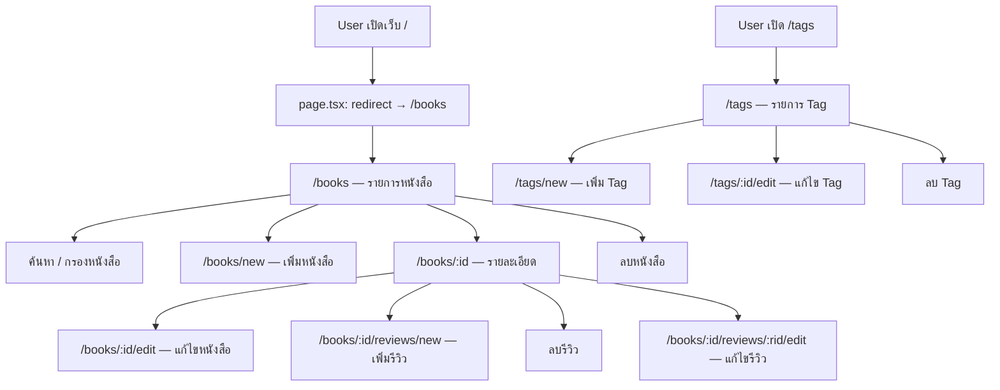
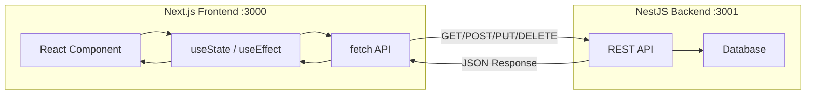
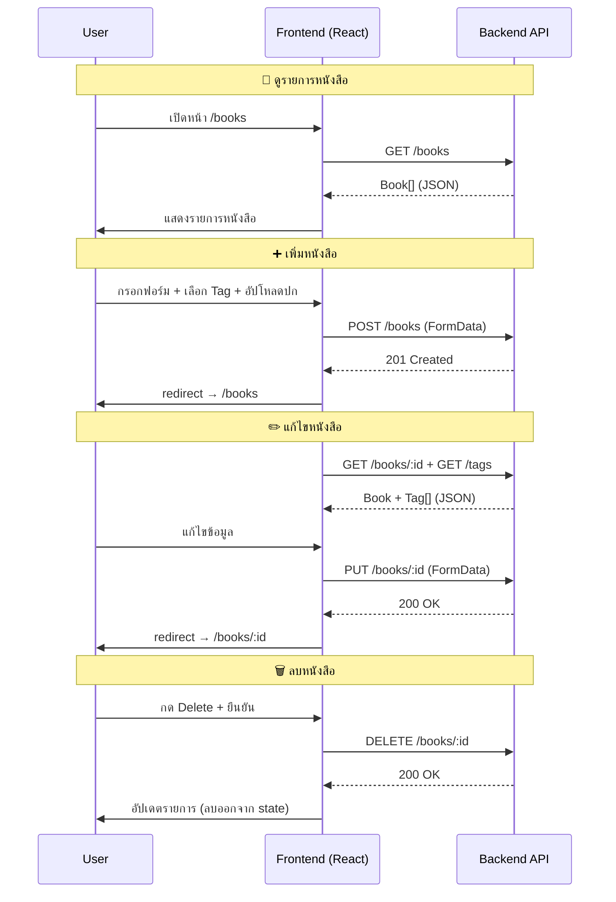
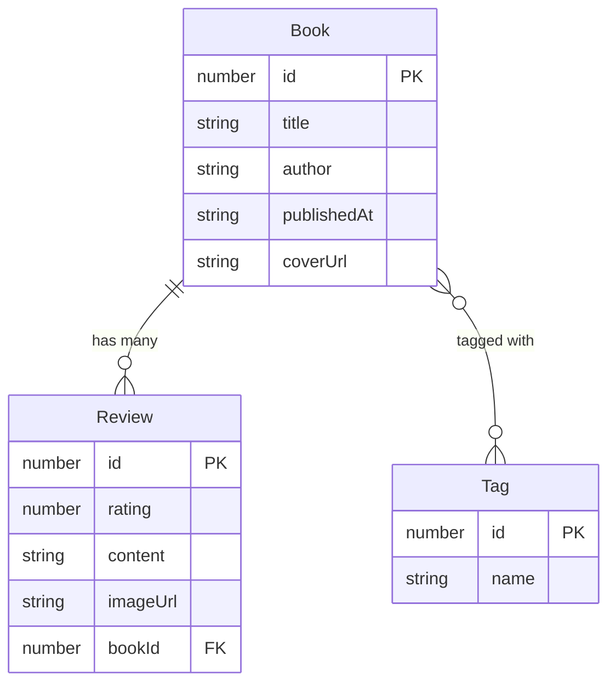
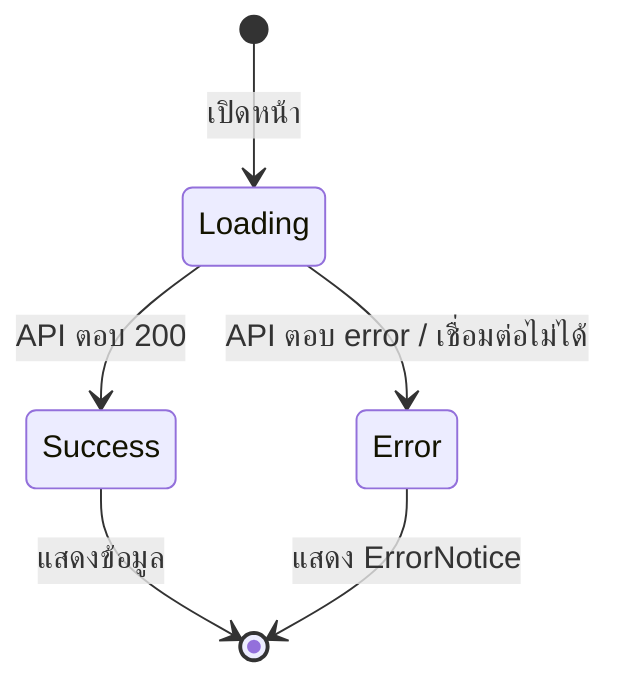
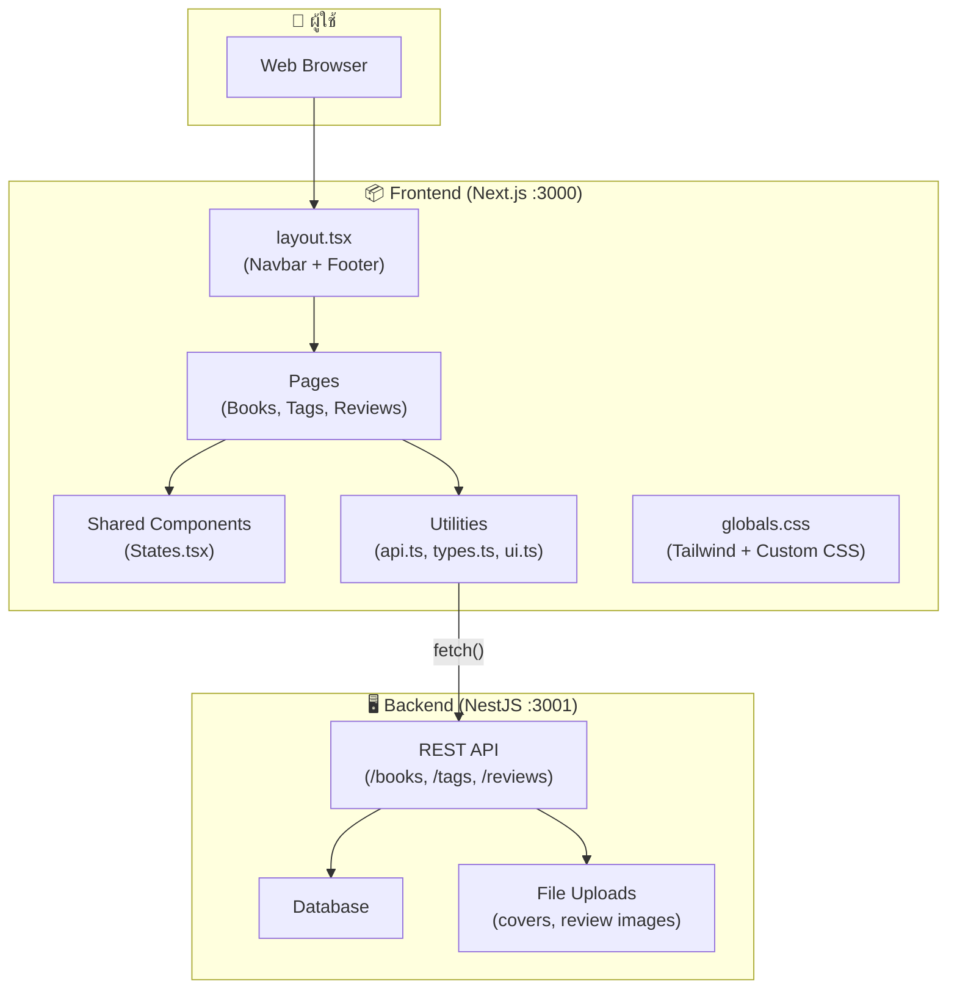

# 📚 Papertrail — Book Review App (Frontend)

## เอกสารอธิบายโค้ด, Flow การทำงาน และคำสั่งที่ใช้

---

## 1. ภาพรวมโปรเจกต์

**Papertrail** คือเว็บแอปพลิเคชันสำหรับจัดการหนังสือและรีวิว สร้างด้วย **Next.js 16** (App Router) + **React 19** + **TypeScript** + **Tailwind CSS 4** โดยเป็นฝั่ง Frontend ที่เชื่อมต่อกับ Backend API (NestJS) ผ่าน REST API

> [!IMPORTANT]
> โปรเจกต์นี้เป็น **Frontend เท่านั้น** — ต้องมี Backend API รันอยู่ที่ `http://localhost:3001` (หรือค่าที่กำหนดใน `.env`)

### เทคโนโลยีที่ใช้

| เทคโนโลยี | เวอร์ชัน | หน้าที่ |
|---|---|---|
| Next.js | 16.4.4 | Framework สำหรับ React ที่รองรับ App Router, SSR |
| React | 19.3.0 | UI Library สำหรับสร้าง Component |
| TypeScript | ^5 | ภาษาที่เพิ่ม Type Safety ให้ JavaScript |
| Tailwind CSS | ^4 | CSS Framework สำหรับจัดรูปแบบ UI |

---

## 2. โครงสร้างไฟล์ (Project Structure)

```
book-final-ui/
├── .env                          # ตั้งค่า URL ของ Backend API
├── next.config.ts                # ตั้งค่า Next.js (Turbopack, CSS)
├── tsconfig.json                 # ตั้งค่า TypeScript
├── package.json                  # Dependencies และ Scripts
├── public/                       # ไฟล์ Static (SVG icons)
└── src/
    ├── app/
    │   ├── layout.tsx            # Layout หลัก (Navbar + Footer)
    │   ├── page.tsx              # หน้าแรก → redirect ไป /books
    │   ├── globals.css           # CSS ทั้งหมดของแอป
    │   ├── books/
    │   │   ├── page.tsx          # รายการหนังสือทั้งหมด
    │   │   ├── new/
    │   │   │   └── page.tsx      # ฟอร์มเพิ่มหนังสือใหม่
    │   │   └── [id]/
    │   │       ├── page.tsx      # รายละเอียดหนังสือ + รีวิว
    │   │       ├── edit/
    │   │       │   └── page.tsx  # ฟอร์มแก้ไขหนังสือ
    │   │       └── reviews/
    │   │           ├── new/
    │   │           │   └── page.tsx       # ฟอร์มเพิ่มรีวิว
    │   │           └── [reviewId]/
    │   │               └── edit/
    │   │                   └── page.tsx   # ฟอร์มแก้ไขรีวิว
    │   └── tags/
    │       ├── page.tsx          # รายการ Tag ทั้งหมด
    │       ├── new/
    │       │   └── page.tsx      # ฟอร์มเพิ่ม Tag
    │       └── [id]/
    │           └── edit/
    │               └── page.tsx  # ฟอร์มแก้ไข Tag
    ├── components/
    │   ├── Navbar.tsx            # แถบเมนูด้านบน
    │   └── States.tsx            # Component UI ที่ใช้ซ้ำ
    └── lib/
        ├── api.ts                # ฟังก์ชันเชื่อมต่อ API
        ├── types.ts              # Type definitions (Book, Tag, Review)
        └── ui.ts                 # CSS class constants
```

---

## 3. Flow การทำงานของแอป

### 3.1 Application Flow (ภาพรวม)



### 3.2 Data Flow (การไหลของข้อมูล)



### 3.3 CRUD Flow สำหรับ Books



---

## 4. อธิบายโค้ดแต่ละไฟล์

### 4.1 ไฟล์ตั้งค่า (Configuration)

#### `.env` — ตั้งค่า API URL

```env
NEXT_PUBLIC_API=http://localhost:3001
```

> [!NOTE]
> `NEXT_PUBLIC_` prefix ทำให้ตัวแปรนี้ใช้ได้ทั้งฝั่ง Server และ Client ของ Next.js

#### `next.config.ts` — ตั้งค่า Next.js

```typescript
import type { NextConfig } from "next";

const nextConfig: NextConfig = {
  // เปิดเครื่องมือ feedback ทดลองของ Next.js
  experimental: {
    agentFeedback: true,
  },
  // เปิด Cache Components และ partial prefetching
  cacheComponents: true,
  partialPrefetching: true,
  // ใช้ Tailwind Turbopack loader สำหรับ CSS
  turbopack: {
    rules: {
      "*.css": {
        loaders: ["@tailwindcss/turbopack"],
        as: "*.css",
      },
    },
  },
};

export default nextConfig;
```

#### `tsconfig.json` — ตั้งค่า TypeScript

```json
{
  "compilerOptions": {
    "target": "ES2017",
    "lib": ["dom", "dom.iterable", "esnext"],
    "strict": true,
    "noEmit": true,
    "module": "esnext",
    "moduleResolution": "bundler",
    "jsx": "react-jsx",
    "paths": {
      "@/*": ["./src/*"]    // alias @/ ชี้ไปที่ src/
    }
  }
}
```

> [!TIP]
> `@/*` alias ทำให้ import ไฟล์ได้สะดวก เช่น `import { API } from "@/lib/api"` แทน `"../../lib/api"`

---

### 4.2 Type Definitions — [`src/lib/types.ts`](file:///e:/work/school/web/book-final-ui/src/lib/types.ts)

กำหนด Type ของข้อมูลที่รับจาก API:

```typescript
// ชนิดข้อมูล Tag
export type Tag = {
  id: number;
  name: string;
};

// ชนิดข้อมูล Review (ผูกกับหนังสือ 1 เล่ม)
export type Review = {
  id: number;
  rating: number;        // คะแนน 1-5
  content: string;       // เนื้อหารีวิว
  imageUrl: string | null; // รูปประกอบ (ไม่บังคับ)
  bookId: number;        // รหัสหนังสือที่รีวิว
};

// ชนิดข้อมูลหนังสือ
export type Book = {
  id: number;
  title: string;
  author: string;
  publishedAt: string;       // วันที่เพิ่ม (ISO string)
  coverUrl: string | null;   // URL ปกหนังสือ
  tags: Tag[];               // Tag ที่ผูกกับหนังสือ
  reviews?: Review[];        // รีวิว (มีเฉพาะหน้ารายละเอียด)
};
```



---

### 4.3 API Utilities — [`src/lib/api.ts`](file:///e:/work/school/web/book-final-ui/src/lib/api.ts)

ฟังก์ชันช่วยเหลือสำหรับเชื่อมต่อ API:

```typescript
// ค่า API base URL — อ่านจาก .env หรือใช้ค่าเริ่มต้น
export const API = (
  process.env.NEXT_PUBLIC_API?.trim() || "http://localhost:3001"
).replace(/\/+$/, "");

// แปลง path รูปจาก backend ให้เป็น URL เต็ม
// เช่น "uploads/cover.jpg" → "http://localhost:3001/uploads/cover.jpg"
export function fileUrl(path?: string | null) {
  if (!path) return null;
  if (/^https?:\/\//i.test(path)) return path; // ถ้าเป็น URL เต็มแล้วส่งคืนเลย
  return `${API}/${path.replace(/^\/+/, "")}`;
}

// อ่านข้อความ error จาก response ของ NestJS
// NestJS ส่ง { message: string | string[] } กลับมาเมื่อเกิดข้อผิดพลาด
export async function errorMessage(response: Response) {
  const body: unknown = await response.json().catch(() => null);
  if (typeof body === "object" && body !== null && "message" in body) {
    const message = body.message;
    if (Array.isArray(message)) return message.join(", ");
    if (typeof message === "string") return message;
  }
  return `Request failed (${response.status} ${response.statusText})`;
}

// แปลง error เป็นข้อความที่อ่านง่าย
// TypeError หมายความว่าเชื่อมต่อ API ไม่ได้
export function messageOf(error: unknown) {
  if (error instanceof TypeError) {
    return `Could not connect to the API at ${API}. Check that the backend is running.`;
  }
  return error instanceof Error ? error.message : "Something went wrong.";
}
```

---

### 4.4 UI Class Constants — [`src/lib/ui.ts`](file:///e:/work/school/web/book-final-ui/src/lib/ui.ts)

```typescript
// className ที่ใช้ซ้ำสำหรับปุ่มและช่องกรอก
export const buttonPrimary = "button button-primary";
export const buttonLight   = "button button-light";
export const buttonDanger  = "button button-danger";
export const buttonSmall   = "button button-small";
export const inputClass    = "form-input";
export const selectClass   = "form-select";
export const textareaClass = "form-textarea";
```

---

### 4.5 Shared Components

#### `Navbar.tsx` — [`src/components/Navbar.tsx`](file:///e:/work/school/web/book-final-ui/src/components/Navbar.tsx)

แถบเมนูด้านบนที่แสดงในทุกหน้า:

```typescript
import Link from "next/link";

export default function Navbar() {
  return (
    <header className="site-header">
      <nav className="nav-shell" aria-label="Main navigation">
        {/* โลโก้ "P" พร้อมชื่อ Papertrail */}
        <Link className="brand" href="/books">
          <span className="brand-mark">P</span>
          <span className="brand-name">Papertrail</span>
        </Link>
        {/* ลิงก์ไปยังหน้าหลัก */}
        <div className="nav-links">
          <Link className="nav-link" href="/books">Books</Link>
          <Link className="nav-link" href="/tags">Tags</Link>
          <Link className="button button-primary nav-add" href="/books/new">
            <span aria-hidden="true">+</span> Add a book
          </Link>
        </div>
      </nav>
    </header>
  );
}
```

#### `States.tsx` — [`src/components/States.tsx`](file:///e:/work/school/web/book-final-ui/src/components/States.tsx)

Component UI ที่ใช้ซ้ำทั่วทั้งแอป:

| Component | หน้าที่ |
|---|---|
| `PageHeading` | ส่วนหัวหน้า (eyebrow, title, description, action button) |
| `LoadingState` | แสดงข้อความ "Loading..." พร้อม animation |
| `ErrorNotice` | แสดงข้อผิดพลาดเป็นกล่องสีแดง |
| `EmptyState` | แสดงข้อความเมื่อรายการว่าง พร้อมปุ่ม CTA |
| `MediaImage` | แสดงภาพจาก URL พร้อม alt text |
| `BookCover` | แสดงปกหนังสือ หรือ placeholder เมื่อไม่มีรูป |

---

### 4.6 Layout หลัก — [`src/app/layout.tsx`](file:///e:/work/school/web/book-final-ui/src/app/layout.tsx)

```typescript
import type { Metadata } from "next";
import "./globals.css";
import Navbar from "@/components/Navbar";

export const metadata: Metadata = {
  title: {
    default: "Papertrail — Book Review",
    template: "%s | Papertrail",
  },
  description: "A quiet corner to discover books and share your reviews.",
};

export default function RootLayout({ children }: Readonly<{ children: React.ReactNode }>) {
  return (
    <html lang="en">
      <body>
        <Navbar />                                    {/* แถบเมนูด้านบน */}
        <main className="main-shell">{children}</main> {/* เนื้อหาหน้า */}
        <footer className="site-footer">
          <span>Papertrail</span>
          <span>A little more reading, a little less scrolling.</span>
        </footer>
      </body>
    </html>
  );
}
```

---

### 4.7 หน้าหลัก (Pages)

#### หน้าแรก — [`src/app/page.tsx`](file:///e:/work/school/web/book-final-ui/src/app/page.tsx)

```typescript
import { redirect } from "next/navigation";

export default function HomePage() {
  redirect("/books");  // ส่งต่อไปหน้ารายการหนังสือทันที
}
```

#### หน้ารายการหนังสือ — [`src/app/books/page.tsx`](file:///e:/work/school/web/book-final-ui/src/app/books/page.tsx)

**Flow:**
1. `useEffect` → `fetch GET /books` → เก็บข้อมูลใน `useState`
2. `useMemo` → กรองรายการตาม query ที่ค้นหา (title, author, tag name)
3. แสดงผล → การ์ดหนังสือพร้อมปก, Tag, ปุ่ม Details / Edit / Delete
4. `removeBook()` → `confirm()` → `fetch DELETE /books/:id` → อัปเดต state

```typescript
"use client";

export default function BooksPage() {
  const [books, setBooks] = useState<Book[]>([]);
  const [loading, setLoading] = useState(true);
  const [error, setError] = useState("");
  const [query, setQuery] = useState("");

  // 1) โหลดหนังสือครั้งเดียวเมื่อเปิดหน้า
  useEffect(() => {
    async function loadBooks() {
      try {
        const response = await fetch(`${API}/books`);
        if (!response.ok) throw new Error(await errorMessage(response));
        setBooks(await response.json());
      } catch (loadError) {
        setError(messageOf(loadError));
      } finally {
        setLoading(false);
      }
    }
    loadBooks();
  }, []);

  // 2) กรองรายการด้วย title, author, tag ในฝั่ง client
  const visibleBooks = useMemo(() => {
    const search = query.trim().toLocaleLowerCase();
    if (!search) return books;
    return books.filter((book) =>
      [book.title, book.author, ...(book.tags ?? []).map((t) => t.name)]
        .join(" ").toLocaleLowerCase().includes(search)
    );
  }, [books, query]);

  // 3) ลบหนังสือ
  async function removeBook(book: Book) {
    if (!window.confirm(`Delete "${book.title}"?`)) return;
    const response = await fetch(`${API}/books/${book.id}`, { method: "DELETE" });
    if (!response.ok) throw new Error(await errorMessage(response));
    setBooks((current) => current.filter((item) => item.id !== book.id));
  }
  // ... render JSX
}
```

#### หน้าเพิ่มหนังสือ — [`src/app/books/new/page.tsx`](file:///e:/work/school/web/book-final-ui/src/app/books/new/page.tsx)

**Flow:**
1. `useEffect` → โหลด Tag ทั้งหมดเพื่อแสดง checkbox
2. User กรอก title, author, เลือก tags, อัปโหลด cover
3. `handleSubmit` → สร้าง `FormData` จาก form → `POST /books`
4. สำเร็จ → `router.push("/books")`

> [!NOTE]
> ใช้ `FormData` แทน JSON เพราะต้องส่งไฟล์รูปภาพ (multipart/form-data)

#### หน้ารายละเอียดหนังสือ — [`src/app/books/[id]/page.tsx`](file:///e:/work/school/web/book-final-ui/src/app/books/%5Bid%5D/page.tsx)

**Flow:**
1. อ่าน `id` จาก URL ด้วย `useParams()`
2. `useEffect` → `GET /books/:id` → ได้ Book พร้อม reviews
3. แสดงปก, ข้อมูล, Tag, รีวิว (พร้อมคะแนนดาว ★☆)
4. `removeReview()` → `DELETE /reviews/:id` → อัปเดต state

#### หน้าแก้ไขหนังสือ — [`src/app/books/[id]/edit/page.tsx`](file:///e:/work/school/web/book-final-ui/src/app/books/%5Bid%5D/edit/page.tsx)

**Flow:**
1. `useEffect` → `Promise.all([GET /books/:id, GET /tags])` โหลดข้อมูลพร้อมกัน
2. เติมค่าเดิมลงในฟอร์ม (defaultValue, defaultChecked)
3. `handleSubmit` → `PUT /books/:id` (FormData)
4. สำเร็จ → `router.push(/books/:id)`

#### หน้าเพิ่มรีวิว — [`src/app/books/[id]/reviews/new/page.tsx`](file:///e:/work/school/web/book-final-ui/src/app/books/%5Bid%5D/reviews/new/page.tsx)

**Flow:**
1. อ่าน `id` (book ID) จาก URL
2. User เลือก rating, เขียนรีวิว, แนบรูป (optional)
3. `handleSubmit` → `FormData` + เพิ่ม `bookId` → `POST /reviews`
4. สำเร็จ → `router.push(/books/:id)`

#### หน้าแก้ไขรีวิว — [`src/app/books/[id]/reviews/[reviewId]/edit/page.tsx`](file:///e:/work/school/web/book-final-ui/src/app/books/%5Bid%5D/reviews/%5BreviewId%5D/edit/page.tsx)

**Flow:**
1. อ่าน `id` + `reviewId` จาก URL
2. `useEffect` → `GET /reviews/:reviewId` → เติมค่าเดิม
3. `handleSubmit` → `PUT /reviews/:reviewId` (FormData)
4. สำเร็จ → `router.push(/books/:id)`

#### หน้ารายการ Tag — [`src/app/tags/page.tsx`](file:///e:/work/school/web/book-final-ui/src/app/tags/page.tsx)

**Flow:**
1. `useEffect` → `GET /tags` → แสดงรายการ Tag
2. `removeTag()` → `DELETE /tags/:id` → อัปเดต state

#### หน้าเพิ่ม Tag — [`src/app/tags/new/page.tsx`](file:///e:/work/school/web/book-final-ui/src/app/tags/new/page.tsx)

**Flow:**
1. User กรอกชื่อ Tag
2. `handleSubmit` → `POST /tags` (JSON: `{ name }`)
3. สำเร็จ → `router.push("/tags")`

#### หน้าแก้ไข Tag — [`src/app/tags/[id]/edit/page.tsx`](file:///e:/work/school/web/book-final-ui/src/app/tags/%5Bid%5D/edit/page.tsx)

**Flow:**
1. `useEffect` → `GET /tags/:id` → เติมค่าเดิม
2. User แก้ชื่อ
3. `handleSubmit` → `PUT /tags/:id` (JSON: `{ name }`)
4. สำเร็จ → `router.push("/tags")`

---

## 5. API Endpoints ที่ Frontend เรียกใช้

| Method | Endpoint | ใช้ในหน้า | คำอธิบาย | Body |
|---|---|---|---|---|
| `GET` | `/books` | Books List | ดึงรายการหนังสือทั้งหมด | — |
| `POST` | `/books` | New Book | สร้างหนังสือใหม่ | FormData (title, author, tagIds, cover) |
| `GET` | `/books/:id` | Book Detail, Edit Book | ดึงรายละเอียดหนังสือ + reviews | — |
| `PUT` | `/books/:id` | Edit Book | แก้ไขหนังสือ | FormData (title, author, tagIds, cover) |
| `DELETE` | `/books/:id` | Books List | ลบหนังสือ | — |
| `GET` | `/tags` | Tags List, New/Edit Book | ดึงรายการ Tag ทั้งหมด | — |
| `POST` | `/tags` | New Tag | สร้าง Tag ใหม่ | JSON `{ name }` |
| `GET` | `/tags/:id` | Edit Tag | ดึงข้อมูล Tag ตาม id | — |
| `PUT` | `/tags/:id` | Edit Tag | แก้ไขชื่อ Tag | JSON `{ name }` |
| `DELETE` | `/tags/:id` | Tags List | ลบ Tag | — |
| `POST` | `/reviews` | New Review | สร้างรีวิวใหม่ | FormData (rating, content, bookId, image) |
| `GET` | `/reviews/:id` | Edit Review | ดึงข้อมูลรีวิว | — |
| `PUT` | `/reviews/:id` | Edit Review | แก้ไขรีวิว | FormData (rating, content, image) |
| `DELETE` | `/reviews/:id` | Book Detail | ลบรีวิว | — |

---

## 6. Routing Map (เส้นทาง URL)

| URL | หน้า | คำอธิบาย |
|---|---|---|
| `/` | `page.tsx` | Redirect → `/books` |
| `/books` | `books/page.tsx` | รายการหนังสือทั้งหมด + ค้นหา |
| `/books/new` | `books/new/page.tsx` | ฟอร์มเพิ่มหนังสือ |
| `/books/:id` | `books/[id]/page.tsx` | รายละเอียดหนังสือ + รีวิว |
| `/books/:id/edit` | `books/[id]/edit/page.tsx` | ฟอร์มแก้ไขหนังสือ |
| `/books/:id/reviews/new` | `books/[id]/reviews/new/page.tsx` | ฟอร์มเพิ่มรีวิว |
| `/books/:id/reviews/:rid/edit` | `books/[id]/reviews/[reviewId]/edit/page.tsx` | ฟอร์มแก้ไขรีวิว |
| `/tags` | `tags/page.tsx` | รายการ Tag ทั้งหมด |
| `/tags/new` | `tags/new/page.tsx` | ฟอร์มเพิ่ม Tag |
| `/tags/:id/edit` | `tags/[id]/edit/page.tsx` | ฟอร์มแก้ไข Tag |

---

## 7. คำสั่งที่ใช้ (Commands)

### 7.1 ติดตั้งโปรเจกต์

```bash
# Clone โปรเจกต์ (ถ้ายังไม่มี)
cd e:\work\school\web\book-final-ui

# ติดตั้ง dependencies
npm install
```

### 7.2 รันโปรเจกต์ (Development)

```bash
# รัน development server พร้อม Turbopack
npm run dev
# → เปิดเว็บที่ http://localhost:3000
```

> [!WARNING]
> ก่อนรัน Frontend ต้องรัน **Backend API** ที่ `http://localhost:3001` ด้วย

### 7.3 Build สำหรับ Production

```bash
# Build แอปสำหรับ production
npm run build

# รัน production server
npm run start
```

### 7.4 ตรวจสอบโค้ด (Linting)

```bash
# ตรวจสอบ code style ด้วย ESLint
npm run lint
```

### 7.5 สรุปคำสั่งทั้งหมด (จาก package.json)

| คำสั่ง | สิ่งที่ทำ |
|---|---|
| `npm run dev` | รัน Next.js development server (port 3000) |
| `npm run build` | Build แอปสำหรับ production |
| `npm run start` | รัน production server |
| `npm run lint` | ตรวจสอบโค้ดด้วย ESLint |

---

## 8. Pattern และ Convention ที่ใช้ในโค้ด

### 8.1 Client Components
ทุกหน้าเป็น **Client Component** (มี `"use client"`) เพราะใช้ `useState`, `useEffect`, `useRouter` ซึ่งทำงานในฝั่ง browser เท่านั้น

### 8.2 การจัดการ State



ทุกหน้าใช้ pattern เดียวกัน:
```typescript
const [data, setData] = useState(initial);       // ข้อมูลจาก API
const [loading, setLoading] = useState(true);     // กำลังโหลด?
const [error, setError] = useState("");           // ข้อความผิดพลาด
const [submitting, setSubmitting] = useState(false); // กำลังส่งฟอร์ม?
```

### 8.3 การส่งข้อมูล
- **มีไฟล์** (หนังสือ, รีวิว) → ใช้ `FormData` (multipart)
- **ไม่มีไฟล์** (Tag) → ใช้ `JSON.stringify` + `Content-Type: application/json`

### 8.4 Dynamic Routes
ใช้ Next.js App Router convention:
- `[id]` → parameter ชื่อ `id`
- `[reviewId]` → parameter ชื่อ `reviewId`
- อ่านด้วย `useParams<{ id: string }>()` ในฝั่ง client

### 8.5 Error Handling
```
fetch() ล้มเหลว → TypeError → messageOf() → "Could not connect to the API..."
response.ok === false → errorMessage() → อ่าน body.message จาก NestJS
```

---

## 9. CSS Architecture — [`globals.css`](file:///e:/work/school/web/book-final-ui/src/app/globals.css)

### ตัวแปรธีม (CSS Custom Properties)

```css
:root {
  --paper: #f7f5ef;        /* สีพื้นหลังหลัก (สีกระดาษ) */
  --surface: #fffefa;      /* สีพื้นการ์ดและ panel */
  --ink: #242a24;          /* สีข้อความหลัก */
  --muted: #73796e;        /* สีข้อความรอง */
  --line: #e8e5db;         /* สีเส้นขอบ */
  --green: #355b45;        /* สีหลักของแบรนด์ */
  --green-dark: #284936;   /* สี hover */
  --green-soft: #eaf0e8;   /* สี Tag และพื้นหลังเบา */
  --orange: #d78850;       /* สีจุด loading */
  --danger: #a63e35;       /* สีปุ่มลบ */
}
```

### Responsive Breakpoints

| Breakpoint | การปรับ |
|---|---|
| ≤ 900px | Grid 4 → 3 คอลัมน์ |
| ≤ 680px | Grid 3 → 2 คอลัมน์, ซ่อนบางส่วน, ปรับ layout เป็น 1 คอลัมน์ |
| ≤ 390px | ซ่อนชื่อ "Papertrail" เหลือแค่โลโก้ "P" |

---

## 10. สรุปภาพรวมระบบ



> [!TIP]
> เพื่อใช้งานแอปนี้ ให้รัน Backend ที่ port 3001 ก่อน แล้วรัน Frontend ที่ port 3000 ด้วยคำสั่ง `npm run dev`
